# 27 - APP QUALITY, GOOGLE PLAY VITALS & ANDROID 2026–2027 ARCHITECTURE STANDARD

## Purpose
This document establishes the project's mandatory architecture and engineering standards for **Google Play Android Vitals (2026–2027 Enforcement), App Quality, Zero-Crash / Zero-ANR / Zero-LMK Engineering, Android 15/16 Platform Mandates, Zero-Tap Sign-In Restoration, and the 2-Tier Hybrid Splash Architecture**.

App Quality is a primary functional requirement. Violating Android Vitals thresholds (evaluated at the **90th percentile — P90** across a rolling 28-day window) leads directly to Google Play Store search demotion, removal from Featuring / Editors' Choice, red warning banners on the store listing, and **restricted publishing capabilities (blocked app updates)**.

---

# 1. QUANTITATIVE GOOGLE PLAY VITALS BUDGETS (2026–2027 ENFORCEMENT)

Google Play monitors all production applications 24/7 across rolling 28-day windows. Exceeding any Bad Behavior Threshold triggers automated store-level penalties and publishing blocks:

```mermaid
flowchart LR
    subgraph Vitals ["GOOGLE PLAY CORE VITALS BUDGETS (2026–2027)"]
        C["User-Perceived Crash Rate\nBad: >= 1.09% (>= 8% per device)\nMandate: < 0.05%"]
        A["User-Perceived ANR Rate\nBad: >= 0.47% (>= 8% per device)\nMandate: < 0.02%"]
        W["Excessive Partial Wake Locks (03/2026)\nBad: >= 2h in 24h (> 5% sessions)\nMandate: 0 Manual WakeLocks"]
        M["Dynamic & Bitmap Memory (02/2027)\nBad: Bitmap > 200MB BG / > 400MB Cached\nMandate: < 50MB BG + onTrimMemory"]
        D["DEX Code Optimization (02/2027)\nBad: < 25% R8 (>10MB App / >50MB Game)\nMandate: >= 75% Opt / >= 80% Obf"]
        S["Cold Start TTID\nBad: >= 5,000ms\nMandate: < 600ms (Warm < 300ms)"]
    end

    subgraph Penalties ["PLAY STORE PENALTIES & BLOCKS"]
        P1["Search & Discovery Demotion"]
        P2["Restricted Publishing (Blocked Updates)"]
        P3["Store Listing Red Warning Banner:\n'App may be unstable / drains battery'"]
        P4["Stripped from Featuring & Top Charts"]
    end

    Vitals ==> Penalties
```



| Metric | Enforcement Milestone | Google Play Bad Threshold (P90 / 28-Day) | Antigravity Mandate Budget | Measurement Method |
| :--- | :--- | :--- | :--- | :--- |
| **User-Perceived Crash Rate** | Active 24/7 | $\ge 1.09\%$ overall ($\ge 8\%$ per device) | **$< 0.05\%$ (1 crash / 2,000 sessions)** | Firebase Crashlytics & Play Vitals |
| **User-Perceived ANR Rate** | Active 24/7 | $\ge 0.47\%$ overall ($\ge 8\%$ per device) | **$< 0.02\%$ (1 ANR / 5,000 sessions)** | StrictMode & Play Vitals |
| **Excessive Partial Wake Locks** | **March 2026** | $\ge 2\text{ hours}$ cumulative in 24h across $> 5\%$ of sessions | **$0$ manual `PARTIAL_WAKE_LOCK`s** (100% `WorkManager` / `UIDT`) | Battery Historian & Play Vitals |
| **16KB Memory Page Alignment** | **May 1, 2026 & Feb 2027** | Any 64-bit `.so` binary not aligned to `16KB` (`0x4000`) | **100% `.so` aligned to `16KB`** (`-Wl,-z,max-page-size=16384`) | `./gradlew check16kb` & `objdump -p` |
| **Target API Level (`targetSdk`)** | **August 31, 2026** | `targetSdk < 36` (Android 16) for new apps & updates | **`compileSdk = 36`, `targetSdk = 36`** | `build.gradle.kts` |
| **Dynamic Memory (RSS + Swap) & LMK** | **February 2027** | Exceeding P90 RAM-tier threshold (`Foreground`, `Service`, `BG`, `Cached`) | **User-Perceived LMK $< 0.01\%$** + `onTrimMemory()` eviction | `LmkRateMetricSet` & Android Profiler |
| **Bitmap Memory Usage** | **February 2027** | Retained Bitmaps $> 200\text{ MB}$ (`BG`/`Service`) or $> 400\text{ MB}$ (`Cached`) | **$< 50\text{ MB}$ in Background** + exact viewport downsampling | Android Studio Memory Profiler |
| **DEX Code Optimization Score** | **February 2027** | $< 25\%$ R8 coverage (Apps $> 10\text{ MB}$ DEX / Games $> 50\text{ MB}$ DEX) | **$\ge 75\%$ Optimized & $\ge 80\%$ Obfuscated** (`fullMode=true`) | `./gradlew :app:analyzeReleaseR8Config` |
| **Zero-Tap Sign-In Restoration** | **April 2027** | Non-game app with login fails to auto-restore session on new device | **100% `Restore Credentials API`** (`androidx.credentials`) | Cross-device Backup & Restore Test |
| **Cold Start (TTID / TTFD)** | Active 24/7 | TTID $\ge 5,000\text{ms}$ / TTFD $\ge 8,000\text{ms}$ | **TTID $< 600\text{ms}$ / TTFD $< 1,200\text{ms}$** | Macrobenchmark & `reportFullyDrawn()` |
| **Slow / Frozen Frames** | Active 24/7 | Slow $\ge 50\%$ ($> 16.6\text{ms}$) / Frozen $\ge 0.1\%$ ($> 700\text{ms}$) | **Slow $< 1.0\%$ / Frozen $0.0\%$** | Jetpack JankStats & FrameMetrics |

---

# 2. ANDROID 15/16 & 2026–2027 MANDATORY PLATFORM COMPLIANCE

### Rule 27.1: 16KB Memory Page Alignment (May 1, 2026 & February 2027 Hard Block)
* **Context:** Starting **May 1, 2026** (and expanding across all 64-bit native code updates in **February 2027**), Google Play blocks updates to apps containing native C/C++ libraries (`.so` files via NDK, Flutter, React Native, or Unity) that are not aligned to 16KB memory page boundaries.
* **The Iron Rule:** Every integrated Native NDK library (`.so` files inside APK/AAB) MUST be compiled with **NDK r28+** (or explicit linker flags) for 16KB page alignment:
  ```text
  -Wl,-z,max-page-size=16384
  ```
* **Rejection Criteria:** Any 3rd-party library bundled with 4KB-only `.so` files triggers an immediate **SIGSEGV Crash** upon launch on 16KB devices and is blocked by Play Console.
* **Verification:** Execute `./gradlew check16kb` or run `objdump -p lib*.so | grep LOAD` to verify `0x4000` (16KB) alignment, and `zipalign -c -P 16 -v 4 <apk>` for uncompressed shared libraries.

---

### Rule 27.2: Target SDK 36 (Android 16 — August 31, 2026), Enforced Edge-to-Edge & Adaptive UI
* **Context:** By **August 31, 2026**, all new apps and updates must target **Android 16 (API 36)**. Android 15/16 permanently removes the opt-out flag (`windowOptOutEdgeToEdgeEnforcement`) for edge-to-edge drawing and enforces adaptive resizability on large screens.
* **The Iron Rule:** All screens MUST explicitly consume system insets and support adaptive layouts:
  1. Call `enableEdgeToEdge()` in `MainActivity.onCreate()` prior to `setContent {}`.
  2. Apply `WindowInsets.safeDrawing` to root containers or top/bottom bars.
  3. Apply `Modifier.imePadding()` to containers with input fields (`TextField`) so the virtual keyboard never obscures active interactive components.
  4. Support `WindowSizeClass` (`Compact`, `Medium`, `Expanded`) without locking portrait orientation on tablets/foldables.
* **Rejection Criteria:** Layouts where the system navigation pill overlaps buttons, where the IME obscures text input fields, or where `windowOptOutEdgeToEdgeEnforcement` is used as a workaround.

---

### Rule 27.3: Excessive Partial Wake Lock Ban (March 2026), FGS Restrictions & Geofencing Removal (January 27, 2027)
* **Context:** Starting **March 2026**, Android Vitals penalizes apps holding $\ge 2\text{ hours}$ of non-exempt partial wake locks in a 24-hour period across $> 5\%$ of sessions. Starting **January 27, 2027**, **Geofencing** is permanently removed as an approved Foreground Service (`foregroundServiceType="location"`) use case.
* **The Iron Rule:**
  1. **Zero Manual WakeLocks:** Never acquire raw `PowerManager.PARTIAL_WAKE_LOCK` for background sync or polling.
  2. **Foreground Services:** Services extending `ForegroundService` MUST declare an explicit `android:foregroundServiceType` (`dataSync`, `mediaPlayback`, `camera`, `location`, `shortService`, etc.) in `AndroidManifest.xml`, be directly user-initiated, and provide a visible stop action.
  3. **Geofencing Migration (Jan 27, 2027 Mandate):** Never use a Foreground Service to monitor geofences; migrate 100% to Google Play Services **`GeofencingClient`** (`GeofencingRequest` + `BroadcastReceiver`).
  4. **WorkManager & UIDT:** Deferrable background tasks MUST use **WorkManager**. User-triggered network uploads/downloads over 10MB MUST use the **User-Initiated Data Transfer (UIDT) API** (`JobInfo.Builder.setUserInitiated(true)` or WorkManager expedited UIDT).

---

### Rule 27.4: Zero-Permission System Pickers (Photo Picker & Contact Picker) & Call Log Ban (January 27, 2027)
* **Context:** Google Play strictly enforces least-privilege system pickers and bans broad permission abuse:
  1. **System Photo Picker (`PickVisualMedia`):** Requesting `READ_EXTERNAL_STORAGE`, `READ_MEDIA_IMAGES`, or `READ_MEDIA_VIDEO` for selecting user media is strictly prohibited.
  2. **System Contact Picker (Jan 27, 2027 Deadline):** Requesting broad `READ_CONTACTS` is restricted unless contact management is the app's primary core function. Apps MUST use the **Android System Contact Picker** (`ActivityResultContracts.PickContact()`).
  3. **Call Log Verification Ban (Jan 27, 2027 Deadline):** Using `READ_CALL_LOG` for phone-call / missed-call account verification is permanently prohibited. Apps MUST migrate to the **Digital Credentials API** or **SMS Retriever API**.
* **The Iron Rule:**
  ```kotlin
  val photoPickerLauncher = rememberLauncherForActivityResult(
      contract = ActivityResultContracts.PickVisualMedia(),
      onResult = { selectedUri -> selectedUri?.let(onMediaSelected) }
  )
  
  photoPickerLauncher.launch(
      PickVisualMediaRequest(ActivityResultContracts.PickVisualMedia.ImageOnly)
  )
  ```

---

# 3. ZERO-CRASH, ZERO-ANR & ZERO-LMK CORE ARCHITECTURE

### Rule 27.5: Zero Main-Thread Blocking & StrictMode Integration
The Main Thread (`Dispatchers.Main`) is reserved exclusively for Compose layout, measurement, and state emission (`< 5ms` budget):
1. **Forbidden on Main Thread:**
   - Disk I/O (File read/write, SharedPreferences sync reads).
   - SQLite / Room database queries or transactions.
   - Network requests (Ktor / OkHttp).
   - Cryptographic operations (AES encryption, KeyStore access).
   - Heavy JSON parsing or reflection-based deserialization.
   - `runBlocking { ... }` or thread sleeps.
2. **Mandatory StrictMode in Debug Builds:**
   ```kotlin
   if (BuildConfig.DEBUG) {
       StrictMode.setThreadPolicy(
           StrictMode.ThreadPolicy.Builder()
               .detectDiskReads()
               .detectDiskWrites()
               .detectNetwork()
               .detectCustomSlowCalls()
               .penaltyLog()
               .penaltyFlashScreen()
               .build()
       )
   }
   ```

---

### Rule 27.6: Centralized Exception Interception & Resilient DTO Mapping
1. **Safe ViewModel Coroutines:** All coroutines MUST be launched via `safeLaunch` (wrapping `CoroutineExceptionHandler`), logging unexpected failures to Crashlytics while preserving `CancellationException` and emitting an MVI error effect.
2. **Resilient DTO Mapping:** Data layer DTO-to-Domain mappers MUST provide safe fallback values. Never allow `NullPointerException` or `SerializationException` to leak into Domain/UI layers.

---

### Rule 27.10: Dynamic Memory (RSS + Swap), Bitmap Memory & LMK Defense (February 2027 Enforcement)
* **Context:** Starting **February 2027**, Android Vitals enforces P90 bad behavior thresholds on **Dynamic Memory Usage (Anonymous RSS + Swap)** across RAM tiers and **Bitmap Memory Usage** ($> 200\text{ MB}$ in `Background` / `User-perceived Service` or $> 400\text{ MB}$ in `Cached` state), alongside tracking **User-Perceived Low Memory Kills (`LmkRateMetricSet`)**.
* **The Iron Rule:**
  1. **Viewport-Exact Image Downsampling:** Never decode full-resolution camera/network images into memory. Always bind image requests (Coil/Glide) to the exact layout bounds and prefer `Bitmap.Config.HARDWARE` for immutable UI bitmaps.
  2. **Mandatory `onTrimMemory` Cache Eviction:** The `Application` class and any custom memory caches MUST respond to OS memory pressure signals (`TRIM_MEMORY_UI_HIDDEN`, `TRIM_MEMORY_BACKGROUND`) by immediately clearing retained bitmap and object caches:
     ```kotlin
     override fun onTrimMemory(level: Int) {
         super.onTrimMemory(level)
         if (level >= ComponentCallbacks2.TRIM_MEMORY_UI_HIDDEN) {
             imageLoader.memoryCache?.clear()
         }
     }
     ```
  3. **Zero Retained Bitmaps in ViewModels:** Never store `android.graphics.Bitmap` or `ImageBitmap` instances inside `UiState` or `ViewModel`; store only lightweight `Uri` or file paths and let the UI image loader manage lifecycle-bound bitmap memory.

---

### Rule 27.11: Mandatory Zero-Tap Sign-In Restoration (`Restore Credentials API` — April 2027 Enforcement)
* **Context:** Starting **April 2027**, Google Play requires all non-game apps supporting user authentication (mandatory or optional) to automatically restore the user's signed-in session the first time they launch the app on a new Android device. Failing to support Zero-Tap Sign-In impacts publishing privileges and store visibility.
* **The Iron Rule:**
  1. **Upon Successful Login:** Generate and persist a hardware-backed restore key via `CredentialManager.createCredential()` using `CreateRestoreCredentialRequest`.
  2. **Upon First Cold Start on a New Device:** Before showing a login screen, query `CredentialManager.getCredential()` with `GetRestoreCredentialOption` to silently restore the user's authenticated session with zero taps.
  3. **Upon Explicit Logout:** Call `CredentialManager.clearCredentialState(ClearCredentialStateRequest(ClearCredentialStateRequest.TYPE_CLEAR_RESTORE_CREDENTIAL))` so logged-out sessions are not resurrected.

---

# 4. STARTUP ACCELERATION & 2-TIER HYBRID SPLASH

### Rule 27.7: 2-Tier Hybrid Splash Architecture (Fast TTID + Orchestrator)
1. **Tier 1 — System Splash (`androidx.core.splashscreen.SplashScreen`):**
   - Installed in `MainActivity.onCreate()` via `installSplashScreen()`.
   - `setKeepOnScreenCondition` is ONLY allowed for instantaneous local initialization (Theme, Core DI) and MUST dismiss in **$< 200\text{ms}$**.
   - **PROHIBITED:** Keeping `setKeepOnScreenCondition = true` to wait for Remote Config, Network, or Ads.
2. **Tier 2 — In-App Brand Splash (Jetpack Compose `SplashRoute`):**
   - Coordinates the asynchronous startup pipeline in parallel with strict fail-safe timeouts:
     - Remote Config Fetch: Timeout $\le 2500\text{ms}$ (Fallback to local default cache if timed out).
     - Splash Ad Load: Timeout $\le 3500\text{ms}$ (Skip ad and proceed immediately if timed out).
     - Total Splash Time Budget: **$\le 5.0\text{s}$ under all network conditions**.
   - Navigation Backstack Cleanup: Upon navigating to `Home`, the Splash route MUST be cleared from the backstack.

---

### Rule 27.8: Baseline Profiles Ahead-Of-Time (AOT) Compilation
* **The Law:** All production release builds MUST include a pre-compiled Baseline Profile (`baseline-prof.txt`) generated via Jetpack Macrobenchmark.
* **Benefit:** Google Play distributes the compiled ART profile with the APK/AAB, enabling immediate AOT compilation upon app install, eliminating JIT stutter and reducing Cold Start time by **up to 40%**.

---

### Rule 27.9: DEX Code Optimization & Uncompressed Size Budget (February 2027 Hard Enforcement)
* **Context:** Starting **February 2027**, Google Play enforces mandatory R8 shrinking, optimization, and obfuscation coverage ($\ge 25\%$ minimum threshold) for all apps with $> 10\text{ MB}$ DEX code and games with $> 50\text{ MB}$ DEX code.
* **The Law:** All production AAB releases MUST satisfy Antigravity's stricter R8 DEX Code Optimization budget:
  1. **Full Mode Enforced:** `android.enableR8.fullMode=true` (Zero disablement).
  2. **Uncompressed DEX Size Measurement:**
     ```bash
     unzip -l <yourapp>.aab | grep -E '\.dex$' | awk '{sum+=$1} END {print sum}'
     ```
  3. **R8 Configuration Analyzer Audit:** Run `./gradlew :app:analyzeReleaseR8Config` to ensure Optimization score **$\ge 75\%$** and Obfuscation score **$\ge 80\%$**.
  4. **Play Console Vitals Clean:** Zero "DEX code optimization" warning banners in Google Play Console App Quality / Vitals dashboard.

---

# 5. ARCHITECTURE COMPLIANCE CHECKLIST (GATE E34 — 2026/2027)

Before declaring any release candidate, feature, or refactor complete, verify:

- [ ] **Google Play Core Vitals Budget (`E34.1`):** Crash Rate $< 0.05\%$, ANR Rate $< 0.02\%$, Cold Start $< 600\text{ms}$, Slow Frames $< 1\%$.
- [ ] **16KB Page Alignment (`E34.2` — May 2026 / Feb 2027):** Verified all `.so` binaries align with `-Wl,-z,max-page-size=16384` (Zero SIGSEGV crashes on 16KB devices).
- [ ] **Target SDK 36 & Enforced Edge-to-Edge (`E34.3` — Aug 2026):** `targetSdk = 36`, `enableEdgeToEdge()`, `WindowInsets.safeDrawing`, and `imePadding()` (No overlapping navigation pills or hidden input fields).
- [ ] **Baseline Profile Included (`E34.4`):** `baseline-prof.txt` bundled in release AAB.
- [ ] **Zero-Permission System Pickers (`E34.5` — Jan 2027):** Media selection via `PickVisualMedia` and contact selection via System Contact Picker (`PickContact`); zero `READ_CALL_LOG` for account verification.
- [ ] **Zero Excessive Wake Locks & FGS Hygiene (`E34.6` — Mar 2026 / Jan 2027):** Zero manual `PARTIAL_WAKE_LOCK`s ($\ge 2\text{h}$); no FGS for Geofencing; deferrable jobs routed to `WorkManager`.
- [ ] **Memory & Bitmap Vitals Budget (`E34.7` — Feb 2027 P90):** Background Bitmap RAM $< 50\text{ MB}$ (Play limit $200\text{ MB}$ BG / $400\text{ MB}$ Cached), `onTrimMemory()` cache eviction implemented, zero Bitmaps held in ViewModels.
- [ ] **DEX Code Optimization Budget (`E34.8` — Feb 2027):** Full Mode active, Optimization $\ge 75\%$, Obfuscation $\ge 80\%$ (exceeding Play's $25\%$ minimum for $>10\text{MB}$ DEX), zero broad package keeps.
- [ ] **Zero-Tap Sign-In Restoration (`E34.9` — Apr 2027):** `Restore Credentials API` (`androidx.credentials`) integrated for automatic cross-device login restoration.
- [ ] **100% Compliant with Enforcement Gate E34.**


