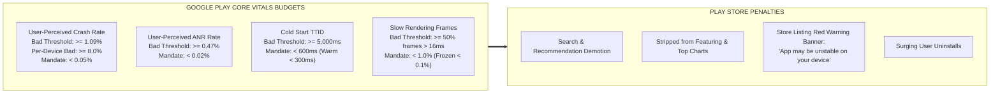

# 27 - APP QUALITY, GOOGLE PLAY VITALS & ANDROID 15/16 ARCHITECTURE STANDARD

## Purpose
This document establishes the project's mandatory architecture and engineering standards for **Google Play Android Vitals, App Quality, Zero-Crash / Zero-ANR Engineering, Android 15/16 Platform Mandates, and the 2-Tier Hybrid Splash Architecture**.

App Quality is a primary functional requirement. Violating Android Vitals thresholds leads directly to Google Play Store search demotion, removal from Featuring / Editors' Choice, red warning banners on the store listing, and elevated uninstall rates.

---

# 1. QUANTITATIVE GOOGLE PLAY VITALS BUDGETS (2025–2026)

Google Play monitors all production applications 24/7 across rolling 28-day windows. Exceeding any Bad Behavior Threshold triggers automated store-level penalties:



| Metric | Google Play Bad Threshold | Antigravity Mandate Budget | Measurement Method |
| :--- | :--- | :--- | :--- |
| **User-Perceived Crash Rate** | $\ge 1.09\%$ ($\ge 8\%$ per device) | **$< 0.05\%$ (1 crash per 2,000 sessions)** | Firebase Crashlytics & Google Play Console |
| **User-Perceived ANR Rate** | $\ge 0.47\%$ | **$< 0.02\%$ (1 ANR per 5,000 sessions)** | StrictMode & Android Vitals |
| **Cold Start (TTID)** | $\ge 5,000\text{ms}$ | **$< 600\text{ms}$ (Time to Initial Display)** | Macrobenchmark & `reportFullyDrawn()` |
| **Cold Start (TTFD)** | $\ge 8,000\text{ms}$ | **$< 1,200\text{ms}$ (Time to Full Display)** | Macrobenchmark & Compose Tracer |
| **Warm / Hot Start** | $\ge 2,000\text{ms}$ / $\ge 1,500\text{ms}$ | **$< 300\text{ms}$ (Warm) / $< 150\text{ms}$ (Hot)** | System Trace / Profiler |
| **Slow Rendering Frames** | $\ge 50\%$ Frames $> 16.6\text{ms}$ | **$< 1.0\%$ Dropped Frames (120/60 FPS)** | Jetpack JankStats & FrameMetrics |
| **Frozen Frames** | $\ge 0.1\%$ Frames $> 700\text{ms}$ | **$0.0\%$ Frozen Frames** | Android Vitals |
| **DEX Code Optimization Score** | Play Console Alert / Low Optimization | **$\ge 75\%$ Optimized ($\ge 80\%$ Obfuscated)** | `./gradlew :app:analyzeReleaseR8Config` & Play Vitals |


---

# 2. ANDROID 15 & 16 MANDATORY PLATFORM COMPLIANCE

### Rule 27.1: 16KB Memory Page Alignment (Native C++ NDK)
* **Context:** Starting with Android 15, flagship hardware introduces 16KB memory page sizes to dramatically improve I/O bandwidth and power efficiency.
* **The Iron Rule:** Every integrated Native NDK library (`.so` files inside APK/AAB) MUST be compiled with 16KB page alignment:
  ```text
  -Wl,-z,max-page-size=16384
  ```
* **Rejection Criteria:** Any 3rd-party library bundled with 4KB-only `.so` files will trigger an immediate **SIGSEGV Crash** upon launch on 16KB devices and is strictly banned.
* **Verification:** Execute `./gradlew check16kb` or run `objdump -p lib*.so | grep LOAD` to verify `0x4000` (16KB) alignment.

---

### Rule 27.2: Enforced Edge-to-Edge & System Insets
* **Context:** Android 15 permanently removes the opt-out flag for edge-to-edge drawing. Applications are rendered full-bleed behind the status bar and navigation bar by default.
* **The Iron Rule:** All screens MUST explicitly consume system insets:
  1. Call `enableEdgeToEdge()` in `MainActivity.onCreate()` prior to `setContent {}`.
  2. Apply `WindowInsets.safeDrawing` to root scaffolds or top app bars.
  3. Apply `Modifier.imePadding()` to containers with input fields (`TextField`) to guarantee the virtual keyboard never obscures active interactive components.
* **Rejection Criteria:** Layouts where the system navigation pill overlaps buttons or where the IME obscures text input fields.

---

### Rule 27.3: Foreground Service (FGS) Restrictions & WorkManager Migration
* **Context:** Android 14/15 strictly restricts background execution to protect battery life and user privacy.
* **The Iron Rule:**
  1. Services extending `ForegroundService` MUST declare an explicit `android:foregroundServiceType` (`dataSync`, `mediaPlayback`, `camera`, `location`, etc.) in `AndroidManifest.xml`.
  2. Long-running or deferrable tasks MUST be migrated to **WorkManager**.
  3. User-triggered network uploads/downloads over 10MB MUST use the **User-Initiated Data Transfer (UIDT) API** (`JobInfo.Builder.setUserInitiated(true)`).

---

### Rule 27.4: Zero-Permission System Photo Picker
* **Context:** Requesting broad storage permissions (`READ_EXTERNAL_STORAGE`, `READ_MEDIA_IMAGES`) solely for selecting user media violates Google Play Privacy Policies.
* **The Iron Rule:** All image/video selection MUST use the AndroidX **System Photo Picker**:
  ```kotlin
  val photoPickerLauncher = rememberLauncherForActivityResult(
      contract = ActivityResultContracts.PickVisualMedia()
  ) { uri -> /* Handle selected URI */ }
  
  // Trigger without requesting ANY runtime permission:
  photoPickerLauncher.launch(PickVisualMediaRequest(ActivityResultContracts.PickVisualMedia.ImageOnly))
  ```

---

# 3. ZERO-CRASH & ZERO-ANR CORE ARCHITECTURE

### Rule 27.5: Zero Main-Thread Blocking & StrictMode Integration
The Main Thread (`Dispatchers.Main`) is reserved exclusively for Compose layout, measurement, and state emission:
1. **Forbidden on Main Thread:**
   - Disk I/O (File read/write, SharedPreferences sync reads).
   - SQLite / Room database queries or transactions.
   - Network requests (Ktor / OkHttp).
   - Cryptographic operations (AES encryption, KeyStore access).
   - Heavy JSON parsing or reflection-based deserialization.
   - `runBlocking { ... }` or thread sleeps.
2. **Mandatory StrictMode in Debug Builds:**
   ```kotlin
   if (BuildConfig.DEBUG) {
       StrictMode.setThreadPolicy(
           StrictMode.ThreadPolicy.Builder()
               .detectDiskReads()
               .detectDiskWrites()
               .detectNetwork()
               .detectCustomSlowCalls()
               .penaltyLog()
               .penaltyFlashScreen()
               .build()
       )
   }
   ```

---

### Rule 27.6: Centralized Exception Interception & Resilient DTO Mapping
1. **Safe ViewModel Coroutines:** All coroutines MUST be launched via `safeLaunch` (wrapping `CoroutineExceptionHandler`), logging unexpected failures to Crashlytics and emitting an MVI error effect.
2. **Resilient DTO Mapping:** Tầng Data mapping DTO sang Domain Model bắt buộc phải có giá trị mặc định an toàn (fallback values). Cấm để `NullPointerException` hoặc `SerializationException` lọt lên tầng Domain/UI.

---

# 4. STARTUP ACCELERATION & 2-TIER HYBRID SPLASH

### Rule 27.7: 2-Tier Hybrid Splash Architecture (Fast TTID + Orchestrator)
1. **Tier 1 — System Splash (`androidx.core.splashscreen.SplashScreen`):**
   - Installed in `MainActivity.onCreate()` via `installSplashScreen()`.
   - `setKeepOnScreenCondition` is ONLY allowed for instantaneous local initialization (Theme, Core DI) and MUST dismiss in **$< 200\text{ms}$**.
   - **PROHIBITED:** Keeping `setKeepOnScreenCondition = true` to wait for Remote Config, Network, or Ads.
2. **Tier 2 — In-App Brand Splash (Jetpack Compose `SplashRoute`):**
   - Coordinates the asynchronous startup pipeline in parallel with strict fail-safe timeouts:
     - Remote Config Fetch: Timeout $\le 2500\text{ms}$ (Fallback to local default cache if timed out).
     - Splash Ad Load: Timeout $\le 3500\text{ms}$ (Skip ad and proceed immediately if timed out).
     - Total Splash Time Budget: **$\le 5.0\text{s}$ under all network conditions**.
   - Navigation Backstack Cleanup: Upon navigating to `Home`, the Splash route MUST be cleared from the backstack.

---

### Rule 27.8: Baseline Profiles Ahead-Of-Time (AOT) Compilation
* **The Law:** All production release builds MUST include a pre-compiled Baseline Profile (`baseline-prof.txt`) generated via Jetpack Macrobenchmark.
* **Benefit:** Google Play distributes the compiled ART profile with the APK/AAB, enabling immediate AOT compilation upon app install, eliminating JIT stutter and reducing Cold Start time by **up to 40%**.

---

### Rule 27.9: DEX Code Optimization & Uncompressed Size Budget
* **The Law:** All production AAB releases MUST undergo R8 DEX Code Optimization compliance verification per Google Play Vitals standards:
  1. **Full Mode Enforced:** `android.enableR8.fullMode=true` (Zero disablement).
  2. **Uncompressed DEX Size Measurement:**
     ```bash
     unzip -l <yourapp>.aab | grep -E '\.dex$' | awk '{sum+=$1} END {print sum}'
     ```
  3. **R8 Configuration Analyzer Audit:** Run `./gradlew :app:analyzeReleaseR8Config` to ensure Optimization score $\ge 75\%$ and Obfuscation score $\ge 80\%$.
  4. **Play Console Vitals Clean:** Zero "DEX code optimization" warning banners in Google Play Console App Quality / Vitals dashboard.

---

# 5. ARCHITECTURE COMPLIANCE CHECKLIST (GATE E34)

Before declaring any release candidate, feature, or refactor complete, verify:

- [ ] **Google Play Vitals Budget:** Crash Rate $< 0.05\%$, ANR Rate $< 0.02\%$, Cold Start $< 600\text{ms}$, Slow Frames $< 1\%$.
- [ ] **DEX Code Optimization Budget:** Full Mode active, Optimization $\ge 75\%$, Obfuscation $\ge 80\%$, zero broad package keeps, zero Play Console DEX warnings.
- [ ] **16KB Page Alignment:** Verified all `.so` binaries align with `-Wl,-z,max-page-size=16384` (Zero SIGSEGV crashes on 16KB devices).
- [ ] **Edge-to-Edge Insets:** Verified `enableEdgeToEdge()`, `WindowInsets.safeDrawing`, and `imePadding()` (No overlapping navigation pills or hidden input fields).
- [ ] **Foreground Service Restrictions:** No undeclared FGS types; deferrable background jobs routed to WorkManager.
- [ ] **System Photo Picker:** Media selection handled via `PickVisualMedia` without broad storage permissions.
- [ ] **StrictMode Clean:** Zero StrictMode disk/network violations on the Main Thread.
- [ ] **Baseline Profile Included:** `baseline-prof.txt` bundled in release AAB.
- [ ] **100% Compliant with Enforcement Gate E34.**

