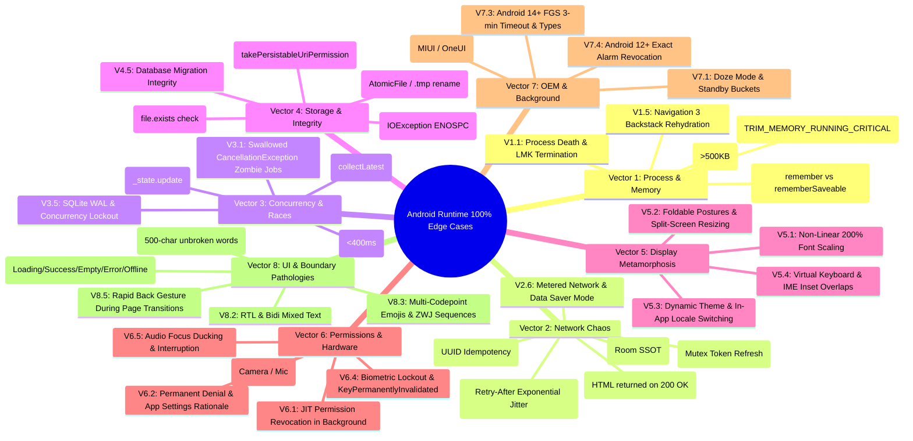

# 39 - Android Hostile Runtime & Edge-Cases Defense Standard

## Purpose

This document establishes the **Universal Android Hostile Runtime & 100% Edge-Cases Defense Standard** across the entire Antigravity Framework.

Mobile operating systems—Android in particular—are fundamentally hostile, asynchronous, and resource-constrained execution environments. Applications run across 25,000+ distinct device models, ranging from budget 1GB RAM Android Go hardware to multi-screen foldables; under volatile cellular networks, hotel captive portals, and airplane modes; through sudden OS process terminations by the Low Memory Killer (LMK); and under aggressive OEM battery managers (Xiaomi MIUI/HyperOS, Samsung OneUI, Transsion HiOS).

Every architectural layer, ViewModel, Composable, Coroutine, and Data Source MUST inherently defend against these conditions by default.

---

# The 8-Vector Hostile Android Runtime Taxonomy



---

# Detailed Defense Contracts by Vector

---

## VECTOR 1: Process, Memory & Lifecycle Hostility

### 1.1 Process Death & SavedStateHandle Rehydration
- **The Threat**: The Android Low Memory Killer (LMK) terminates the app process in background without calling `onDestroy()`. Upon return, Activity is recreated, but in-memory ViewModels, Repositories, and Singletons are wiped.
- **Mandatory Defense**:
  1. ViewModels managing critical screen state or multi-step wizard flows MUST receive `SavedStateHandle`.
  2. Rehydrate state by restoring minimal identifiers (`orderId`, `tabIndex`, `draftQuery`) from `SavedStateHandle`, then trigger reactive Flow from Room SSOT.
  3. Never store active lambdas, Flow objects, or large entity lists in `SavedStateHandle`.

### 1.2 `TransactionTooLargeException` Defense
- **The Threat**: Storing heavy bitmap byte arrays, large lists, or complex nested models in Intent extras, Navigation backstack bundles, or `SavedStateHandle` exceeds the 1MB IPC Binder buffer limit, throwing a fatal `TransactionTooLargeException`.
- **Mandatory Defense**:
  1. IPC Binder bundles MUST NEVER exceed **500KB**.
  2. Large data payloads MUST be written to disk (Room DB, DataStore, or cache file) and referenced solely by UUID / ID string in bundles.

### 1.3 Ephemeral UI State Defense (`remember` vs `rememberSaveable`)
- **The Threat**: User inputs draft text, expands an accordion, or scrolls down a list. A theme change or configuration change wipes the state if held only via `remember`.
- **Mandatory Defense**:
  - All interactive UI draft states (search query, input form values, active filter tab) MUST use `rememberSaveable`.

### 1.4 Dynamic Memory Pressure (`onTrimMemory`)
- **The Threat**: System RAM drops below critical threshold, initiating aggressive task kills.
- **Mandatory Defense**:
  - Register `ComponentCallbacks2` listener. On `TRIM_MEMORY_RUNNING_CRITICAL` or `TRIM_MEMORY_BACKGROUND`, immediately evict in-memory bitmap pools (e.g. Coil disk cache fallback) and drop volatile LRU caches.

---

## VECTOR 2: Network Chaos & Transport Hostility

### 2.1 Hard Offline & Airplane Mode
- **The Threat**: Network unavailable on request trigger.
- **Mandatory Defense**:
  1. Presentation layer NEVER queries network directly; it observes Room database (SSOT).
  2. When offline, display cached data immediately with an informative offline sync status bar.
  3. Offline mutations MUST be written to an Outbox table with UUID v4 idempotency keys.

### 2.2 The Captive Portal Trap
- **The Threat**: The device connects to Wi-Fi (Hotel/Airport), `NetworkInfo.isConnected` returns `true`, but an HTTP 200 OK or 302 Redirect returns an HTML web login page instead of the expected JSON payload. Parsing crashes with `SerializationException`.
- **Mandatory Defense**:
  1. Validate `NetworkCapabilities.NET_CAPABILITY_VALIDATED` via `ConnectivityManager`.
  2. Before JSON deserialization, HTTP client MUST verify `Content-Type: application/json`. If `text/html` is detected, map to `NetworkError.CaptivePortalDetected` and alert the user.

### 2.3 401 Unauthorized Concurrency Race & Refresh Loop
- **The Threat**: Access token expires. 5 parallel API calls fail with 401 simultaneously. Without synchronization, 5 refresh calls trigger in parallel, corrupting tokens and logging out the user.
- **Mandatory Defense**:
  - Token refresh MUST be serialized through a single `kotlinx.coroutines.sync.Mutex`.
  - All pending concurrent requests await the active refresh job and retry with the new token.
  - If refresh token itself fails (401/403), emit a single `ForceLogout` event and clear credentials without recursion.

### 2.4 HTTP 429 Rate Limit & Exponential Jitter Backoff
- **The Threat**: Server responds with 429 Too Many Requests. Fixed polling causes server IP bans.
- **Mandatory Defense**:
  - Parse `Retry-After` response header.
  - Calculate delay as `retryAfterSeconds + Random.nextLong(100, 1000)` (Full Jitter).

---

## VECTOR 3: Concurrency, Coroutines & Race Conditions

### 3.1 The Swallowed `CancellationException` Sin
- **The Threat**: Using `try { ... } catch (e: Exception)` or `catch (t: Throwable)` without re-throwing `CancellationException` breaks Kotlin Structured Concurrency. The cancelled coroutine becomes a zombie job leaking memory and background bandwidth.
- **Mandatory Defense**:
  ```kotlin
  inline fun <T> safeCatching(block: () -> T): Result<T> =
      runCatching(block).onFailure { if (it is CancellationException) throw it }
  ```
  Never swallow `CancellationException` in any layer.

### 3.2 Rapid Multi-Tap & Duplicate Submit Races
- **The Threat**: User rapidly double-clicks "Pay" or "Submit" within 50ms, triggering duplicate transactions or double-pushing screens in Navigation 3.
- **Mandatory Defense**:
  1. UI Level: Apply a 400ms debouncing pointer modifier (`Modifier.singleClick { ... }`).
  2. ViewModel Level: Lock mutation via `if (state.value.isLoading) return@launch` or atomic Mutex.

### 3.3 Out-of-Order Async Overwrites (Stale Data Race)
- **The Threat**: User searches "A" (takes 1000ms), then "AB" (takes 200ms). Result for "AB" arrives first. 800ms later, result for "A" finishes and overwrites the screen with stale data!
- **Mandatory Defense**:
  - Use `collectLatest` or `transformLatest` for all search/filter input pipelines to auto-cancel superseded asynchronous queries.

### 3.4 Atomic State Updates in StateFlow
- **The Threat**: `_state.value = _state.value.copy(...)` is NOT thread-safe under concurrent coroutines. Updates overwrite and drop intermediate changes.
- **Mandatory Defense**:
  - Always mutate StateFlow via atomic `_state.update { it.copy(...) }`.

---

## VECTOR 4: Storage, Disk I/O & File Integrity

### 4.1 Disk Saturation (`IOException: ENOSPC`)
- **The Threat**: Device storage is full. Database write or file download crashes with `IOException: No space left on device`.
- **Mandatory Defense**:
  - Wrap all file and database persistence in safe I/O blocks catching `IOException`.
  - Check `StatFs(path).availableBytes` prior to initiating downloads > 10MB.

### 4.2 Corrupted / Partial File Writes
- **The Threat**: App process killed or device runs out of battery mid-way through writing a file via raw `FileOutputStream`, leaving a corrupted, unreadable file.
- **Mandatory Defense**:
  - Use `androidx.core.util.AtomicFile` or write to a temporary `.tmp` file and perform an atomic POSIX file rename (`tmpFile.renameTo(targetFile)`) upon completion.

### 4.3 Scoped Storage URI Expiration
- **The Threat**: SAF `content://` URI returned from document/media picker becomes invalid after app restart.
- **Mandatory Defense**:
  - Call `context.contentResolver.takePersistableUriPermission(uri, Intent.FLAG_GRANT_READ_URI_PERMISSION)`.

---

## VECTOR 5: Configuration Changes & Dynamic Display Metamorphosis

### 5.1 Non-Linear 200% Accessibility Font Scaling
- **The Threat**: Android 14+ supports non-linear font scaling up to 200%. Hardcoded text heights or single-line constraints cause text clipping, ellipses everywhere, or buttons pushed off-screen.
- **Mandatory Defense**:
  - Never use fixed height modifiers (`Modifier.height(48.dp)`) on containers containing text; use `Modifier.defaultMinSize(minHeight = 48.dp)`.
  - Ensure all form screens are enclosed in a scrollable container (`Modifier.verticalScroll(rememberScrollState())`).

### 5.2 Virtual Keyboard (IME) & Autofill Toolbar Overlaps
- **The Threat**: Soft keyboard pops up with predictive autofill bars, obscuring the active input field or bottom CTA button.
- **Mandatory Defense**:
  - Apply `Modifier.imePadding()` to the root container.
  - Bind input fields with `BringIntoViewRequester` to automatically bring focused inputs into view on focus gain.

---

## VECTOR 6: Permissions, Sensors & Hardware Degradation

### 6.1 Just-In-Time (JIT) Runtime Permission Verification
- **The Threat**: User grants permission, puts app in background, revokes permission in Android Settings, and returns. App crashes assuming permission is still granted.
- **Mandatory Defense**:
  - Never cache permission status in static variables or ViewModel memory.
  - Always call `ContextCompat.checkSelfPermission` immediately before hardware API access.

### 6.2 Permanent Denial ("Don't Ask Again")
- **The Threat**: User permanently denies permission. App repeatedly requests permission in a dead loop.
- **Mandatory Defense**:
  - Check `ActivityCompat.shouldShowRequestPermissionRationale`. If false after denial, show educational dialog with deep link to `Settings.ACTION_APPLICATION_DETAILS_SETTINGS`.

### 6.3 Hardware Sensor In-Use Conflicts
- **The Threat**: Camera hardware in use by another app or flashlight enabled throws `CameraAccessException: CAMERA_IN_USE`.
- **Mandatory Defense**:
  - Catch hardware-specific exceptions and provide friendly error states rather than unhandled crashes.

---

## VECTOR 7: OEM Battery Aggression & Background Throttling

### 7.1 Doze Mode & Standby Buckets
- **The Threat**: System enters Doze; network is cut and alarms deferred.
- **Mandatory Defense**:
  - All background synchronization MUST use `WorkManager` with `Constraints(requiredNetworkType = NetworkType.CONNECTED)`.

### 7.2 Android 14+ Foreground Service (FGS) Restrictions
- **The Threat**: FGS without declared type crashes immediately on Android 14+. Short Service exceeding 3 minutes crashes with `ForegroundServiceDidNotStartInTimeException`.
- **Mandatory Defense**:
  - Explicitly declare `foregroundServiceType` in `AndroidManifest.xml`.
  - Implement `Service.onTimeout` for Short Services to gracefully shut down before OS termination.

---

## VECTOR 8: UI, Input & Boundary Pathologies

### 8.1 Pathological Strings & RTL Bidi Defense
- **The Threat**: 500-character unbroken strings (German compound words, long URLs) or mixed RTL (Arabic/Hebrew) and LTR (English) break layout geometry.
- **Mandatory Defense**:
  - Text components MUST specify `overflow = TextOverflow.Ellipsis` and `softWrap = true`.
  - Modifiers MUST use `start`/`end` instead of `left`/`right`.

### 8.2 5-State UI Matrix Completeness
- **The Threat**: Screens that only handle Loading and Success hang on empty lists or offline errors.
- **Mandatory Defense**:
  - 100% of screens MUST exhaustively handle: `Loading`, `Success`, `Empty`, `Error`, and `Offline`.

---

# Drop-in Minimalist Kotlin Blueprints (Rule 32 Compliant)

### Blueprint 1: Safe Cancellation Runner
```kotlin
package com.example.core.runtime

import kotlin.coroutines.cancellation.CancellationException

inline fun <T> safeCatching(block: () -> T): Result<T> =
    runCatching(block).onFailure { if (it is CancellationException) throw it }
```

### Blueprint 2: Single-Click Pointer Debounce Modifier
```kotlin
package com.example.core.runtime

import androidx.compose.foundation.clickable
import androidx.compose.runtime.remember
import androidx.compose.ui.Modifier
import androidx.compose.ui.composed
import android.os.SystemClock

fun Modifier.singleClick(
    debounceMs: Long = 400L,
    onClick: () -> Unit
): Modifier = composed {
    val lastClickTime = remember { longArrayOf(0L) }
    clickable {
        val now = SystemClock.elapsedRealtime()
        if (now - lastClickTime[0] >= debounceMs) {
            lastClickTime[0] = now
            onClick()
        }
    }
}
```

### Blueprint 3: Atomic File Writer
```kotlin
package com.example.core.runtime

import androidx.core.util.AtomicFile
import java.io.File
import java.io.FileOutputStream
import java.io.IOException

fun File.writeAtomic(data: ByteArray) {
    val atomicFile = AtomicFile(this)
    var stream: FileOutputStream? = null
    try {
        stream = atomicFile.startWrite()
        stream.write(data)
        atomicFile.finishWrite(stream)
    } catch (e: IOException) {
        if (stream != null) {
            atomicFile.failWrite(stream)
        }
        throw e
    }
}
```

---

# Enforcement Audit

All code changes MUST pass **Enforcement Gate E30** in `rules/21-enforcement-engine.md`.
