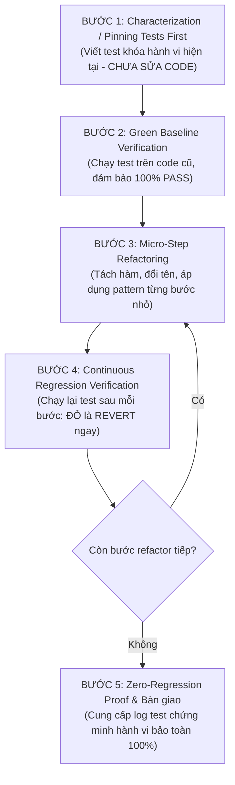

# 40 - Senior Refactoring Safety Net & Characterization Testing Mandate

## Purpose

This document establishes the official **Senior Refactoring Safety Net & Characterization Testing Mandate** across the entire Antigravity Framework.

As defined by Martin Fowler:
> *"Refactoring is a disciplined technique for restructuring an existing body of code, altering its internal structure without changing its observable external behavior."*

And by Michael Feathers (*"Working Effectively with Legacy Code"*):
> *"To edit code without tests is to gamble with the system's stability. When you refactor without a test harness, you are not refactoring; you are introducing silent regressions."*

Jumping straight into code modification during a refactor task without writing tests first is strictly forbidden across all projects.

---

# The 5-Step Refactoring Safety Net Protocol

Every refactoring, cleanup, modernization, or architectural migration task MUST follow this strict sequence:

---

# Detailed Step Protocols

### Step 1: Characterization / Pinning Tests First (Khóa Hành Vi Hiện Tại)
- **Production Code Freeze**: Before touching even a single line or character of the production code being refactored, the AI MUST write a comprehensive suite of Characterization (Pinning) Tests.
- **Coverage Dimensions**:
  1. *Happy Path*: Typical valid inputs and expected outputs.
  2. *Data Boundaries*: Empty inputs, blanks, nulls, zero, max values, extreme strings.
  3. *State Transitions*: ViewModel state flow emissions, loading states, and error handling.
  4. *Side Effects*: Database writes, network calls, navigation effects.

### Step 2: Establish the Green Baseline (Xác Lập Mốc Xanh)
- Execute the test suite against the **untouched production code** (`./gradlew testDebugUnitTest`).
- 100% of Characterization Tests MUST PASS before moving to Step 3.
- If a test fails: It indicates a misunderstanding of the current behavior. Adjust the test assertions to accurately reflect the actual existing behavior.

### Step 3: Micro-Step Refactoring (Refactor Từng Bước Cực Nhỏ)
- Make exactly ONE atomic structural transformation at a time:
  - Extract Function / Method
  - Rename for Ubiquitous Language clarity
  - Hoist State to single-expression or ViewModel
  - Decouple tight dependencies via interfaces / DI
  - Replace procedural loops with idiomatic Kotlin stdlib (`map`, `filter`, `associateBy`)
- Never combine multiple large structural changes in one edit.

### Step 4: Continuous Regression Verification (Chạy Lại Test Sau Mỗi Bước)
- Immediately re-run the Characterization Test suite after each micro-step.
- **THE RED STOP RULE**: If any test turns Red, STOP IMMEDIATELY.
  - Do NOT attempt to "patch" or write more code on top of a red test.
  - Revert the micro-step to the last Green state, re-evaluate, and re-apply cleanly.

### Step 5: Zero-Regression Proof & Clean-up (Xác Nhận & Bàn Giao)
- Execute the full verification suite (`./gradlew testDebugUnitTest compileDebugKotlin`).
- Capture and provide concrete terminal output proving zero regressions.
- If the refactoring introduced new APIs or behavior, write separate TDD unit tests for the new features.

---

# Mandatory Refactoring Invariants

1. **Rule 40.1 (Zero Pre-emptive Edits)**: An agent MUST NEVER edit target production files before the corresponding test file exists and passes.
2. **Rule 40.2 (Test Behavior, Not Structure)**: Characterization tests must assert public inputs, public outputs, and public StateFlows—never private helper methods that will be deleted during refactoring.
3. **Rule 40.3 (Instant Revert on Red)**: Fixing a broken refactoring by piling on more untested code is strictly prohibited. Revert to Green first.
4. **Rule 40.4 (Preserve Existing Edge-Cases)**: Refactoring must not accidentally "fix" or alter existing edge-case quirks unless explicitly requested by the user.

---

# Enforcement Audit

All refactoring tasks MUST pass **Enforcement Gate E32** in `rules/21-enforcement-engine.md`.
