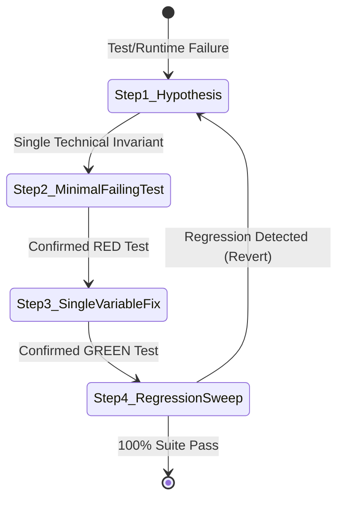

# 41 - SCIENTIFIC CLOSED-LOOP DEBUGGING & SELF-HEALING PROTOCOL

## Purpose
This rule defines the mandatory protocol for diagnosing, isolating, and fixing bugs, test failures, or runtime regressions.

It establishes an absolute prohibition against "Vibe Debugging" (guesswork, random trial-and-error, symptom suppression) and enforces the 4-step scientific method as an automated closed-loop state machine.

---

# 1. THE ABSOLUTE BAN ON VIBE DEBUGGING

Vibe Debugging is the anti-engineering practice of randomly editing code until tests pass or the app stops crashing.

```text
❌ FORBIDDEN: VIBE DEBUGGING CYCLE
Bug / Test Red ──► Guesswork ──► Shotgun Edit ──► Hope it works ──► Hidden Regressions
```

### The 4 Cardinal Sins of Vibe Debugging (Instant Reject)
1. **Shotgun Edits (Sửa lan man):** Modifying multiple variables, methods, or files simultaneously without isolating which change resolved the failure.
2. **Symptom Suppression (Bịt mắt bắt dê):** Adding null checks (`if (x == null) return`) or wrapping code in `try-catch` to silence crashes without understanding *why* the invalid state occurred.
3. **Ghost Fixes (Sửa mà không tái hiện):** Editing production code without first creating a test that deterministically reproduces the exact failure.
4. **Timing Hacks (Chữa cháy bằng delay):** Adding `delay(200)` or thread sleeps to bypass concurrency races instead of fixing mutex/channel synchronization.

---

# 2. THE 4-STEP SCIENTIFIC CLOSED-LOOP PROTOCOL

Every bug fix or test repair MUST transition through this deterministic 4-step state machine:



---

### Step 1: Root-Cause Technical Hypothesis (Single Invariant)
Analyze the stacktrace, logs, and system invariants. Formulate **exactly ONE falsifiable technical hypothesis**:
* **Statement Format:** *"Component `X` fails with `Y` under condition `Z` because invariant `W` is violated at line `L`."*
* **Example:** *"AuthRepository emits Unauthenticated state during token refresh because the 401 response triggers a concurrent second refresh before the Mutex is locked."*
* **Constraint:** If multiple potential causes exist, rank them by probability and test them strictly one by one. Never combine hypotheses.

---

### Step 2: Minimal Failing Isolation Test (Red State Proof)
Before touching a single byte of production code, write a minimal reproduction test:
* **The Iron Rule:** **NO PRODUCTION CODE EDITS WHILE THE REPRODUCTION TEST DOES NOT EXIST.**
* **Execution:** Run the isolation test. It MUST fail with the exact stacktrace or assertion failure predicted in Step 1.
* **Traceability:** Tag the test with `@Scenario("BUG-<ID>")` or descriptive name:
  ```kotlin
  @Test
  fun refreshToken_concurrent401_triggersSingleRefreshCall() = runTest {
      // 1. Arrange: Setup concurrent 401 triggers
      // 2. Act: Trigger concurrent API calls
      // 3. Assert: Must fail before the fix is applied (RED)
  }
  ```

---

### Step 3: Single-Variable Atomic Fix (Green State Proof)
Apply the minimal sufficient change to production code:
* **Minimal Scope:** Touch ONLY the exact variable, branch, or logic identified in the Step 1 hypothesis.
* **Zero Refactoring during Fix:** Do not clean up formatting, rename unrelated variables, or rewrite neighboring functions. Keep the diff atomic and surgical.
* **Verification:** Run the isolation test. It MUST flip from RED to GREEN.

---

### Step 4: Full Regression Sweep (Zero Side-Effects)
Prove that the fix did not silently break adjacent behaviors:
* **Execution:** Run the complete test suite:
  ```bash
  ./gradlew testDebugUnitTest
  ```
* **Instant Revert Rule:** If any existing test fails:
  1. Immediately REVERT the change.
  2. Discard the hypothesis (it introduced side effects).
  3. Return to Step 1 with new data.

---

# 3. SCIENTIFIC ROOT-CAUSE DEDUCTION MATRIX

| Failure Type | Wrong Approach (Vibe Debugging) | Scientific Protocol Approach (Rule 41) |
| :--- | :--- | :--- |
| **`NullPointerException` / `Null `** | Add `?.let {}` or `?: return` everywhere. | Trace origin: Why was the field null? Fix at the source (API deserialization / Domain mapping). |
| **StateFlow not updating UI** | Switch to `SharedFlow(replay = 1)` or add `delay(50)`. | Inspect Compose subscription lifecycle (`collectAsStateWithLifecycle`) and State equality (`copy()` with distinct values). |
| **Flaky / Racing Coroutine Test** | Add `advanceTimeBy(1000)` or `delay()`. | Use `StandardTestDispatcher`, Turbine `awaitItem()`, and UnconfinedTestDispatcher for immediate scheduling. |
| **Process Death Crash** | Initialize variables with dummy data in `onCreate`. | Restore state via `SavedStateHandle` and test using `StateKeeper` or simulated bundle restoration. |
| **Out of Memory / Leak** | Increase JVM heap size in `gradle.properties`. | Dump heap profile, inspect long-lived lambda captures or retained ViewModel references. |

---

# 4. ENFORCEMENT & COMPLIANCE

Any bug fix submitted without:
1. An explicit Root-Cause Hypothesis.
2. A committed Minimal Failing Test proving reproduction.
3. A single-variable surgical diff.
4. Execution evidence of a clean `./gradlew testDebugUnitTest` run.

**WILL BE INSTANTLY REJECTED by Gate E33.1 & E33.2.**
