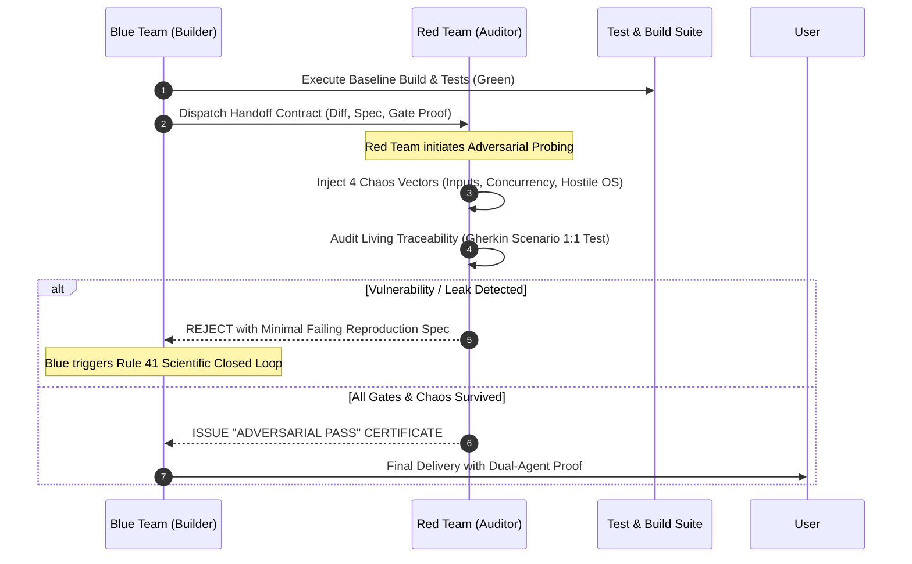

# 42 - ADVERSARIAL RED-TEAM VERIFICATION & DUAL-AGENT AUDIT

## Purpose
This rule defines the mandatory protocol for independent adversarial auditing to eliminate **Confirmation Bias** (Thiên kiến tự duyệt).

In Level 5 Agentic Engineering, no agent is permitted to be the sole evaluator and approver of its own critical code. Every major feature, refactor, or core module must pass an independent **Red-Team Adversarial Audit** before final delivery.

---

# 1. THE PROBLEM: CONFIRMATION BIAS IN SINGLE AGENTS

When the same agent writes code and then performs self-audit:
* It tests the scenarios it already planned for (Happy-path & expected errors).
* It unconsciously ignores blind spots, race conditions, and subtle state leaks.
* It exhibits false confidence ("All checks pass").

```text
❌ FLAWED (Single-Agent Self-Approval):
Author Agent ──► Codes Feature ──► Self-Audit ("Looks good!") ──► Production Crashes

✅ LEVEL 5 (Dual-Agent Adversarial Verification):
Blue Team (Builder) ──► Implements & Pinning Tests
       │
       ▼ Handoff Contract
Red Team (Adversarial Auditor) ──► Active Chaos Injection & Gate E1-E33 Audit
       │
       ├──► CRACK FOUND ──► Rejection ──► Rule 41 Scientific Closed Loop
       │
       └──► ZERO CRACKS ──► "Adversarial Pass" Certificate ──► User Delivery
```

---

# 2. THE DUAL-AGENT ROLES & SEPARATION OF POWERS

### Blue Team (The Builder / Implementer)
* **Responsibilities:**
  1. Author the SDD Tri-Artifact (`spec.md`, `plan.md`, `tasks.md`).
  2. Implement Pinning Tests (Rule 40) or Minimal Failing Tests (Rule 41).
  3. Write minimalist, production-ready code (Rule 32).
  4. Ensure `./gradlew testDebugUnitTest` and compilation pass cleanly.
  5. Package the implementation into a **Handoff Contract** for the Red Team.

### Red Team (The Adversarial Auditor / Chaos Monkey)
* **Mindset:** Extreme skepticism. The Red Team assumes the code is broken until proven otherwise.
* **Core Mission:** Actively attempt to break the code using the **4 Chaos Vectors**:
  1. **Chaotic Input Stress:** Empty strings, 10,000-char overflows, Unicode surrogates, Bidi RTL/LTR, emojis, malformed JSON keys.
  2. **Concurrency & Race Injection:** Simulated rapid multi-taps (< 400ms), out-of-order Flow emissions, simultaneous token refresh calls (401 stampede).
  3. **Hostile Runtime Attacks:** Simulated Process Death with missing SavedState bundle, Captive Portal HTML disguised as 200 OK, JIT permission revoked mid-flight.
  4. **Enforcement Gate Audit:** Exhaustive verification against Gates E1 through E33 without developer leniency.

---

# 3. THE ADVERSARIAL AUDIT PROTOCOL



---

# 4. THE HANDOFF CONTRACT SPECIFICATION

Before the Red Team begins auditing, the Blue Team must supply:
1. **Spec & Scenario IDs:** List of all Gherkin Scenarios (`@Scenario("ID")`) in `spec.md`.
2. **Living Traceability Proof:** Direct references to test functions implementing each Scenario ID.
3. **The Exact Diff:** List of modified and newly created files.
4. **Clean Baseline Execution:** Log output of passing unit tests and zero-lint report.

---

# 5. RED-TEAM AUDIT CHECKLIST (THE CHAOS GATE E33.4)

The Red Team auditor must execute the following verifications:

- [ ] **Living Traceability Integrity:** Is every Scenario in `spec.md` covered by at least one dedicated test? Are there orphaned scenarios or untested branches?
- [ ] **Adversarial Input Immunity:** Does the component handle blank strings, negative values, maximum integer overflow, and malformed DTO fields without crashing?
- [ ] **State Machine Resilience:** Can the user spam click the action button 5 times within 300ms without triggering duplicate network requests or corrupting ViewModel state?
- [ ] **Lifecycle Survival:** Does the state recover cleanly from `SavedStateHandle` after process death without re-fetching unnecessary initial data?
- [ ] **Coroutines Cancellation Safety:** Are all child jobs cancelled when ViewModel clears or Composable leaves composition? Are there swallowed `CancellationException`s?
- [ ] **Minimalist Code Audit (Rule 32):** Is there any over-engineered bloat (redundant wrappers, premature abstractions, boilerplate singletons)?

---

# 6. RESOLUTION OF ADVERSARIAL DEFECTS

If the Red Team identifies any defect, edge-case vulnerability, or gate violation:
1. The Red Team outputs a **Defect Report** containing:
   - Violated Invariant or Gate ID.
   - Exact Reproduction Scenario (Input / State / Threading).
2. The Blue Team **MUST NOT** argue or dismiss the report.
3. The Blue Team **MUST** enter **Rule 41 (Scientific Closed-Loop Debugging)**:
   - Formulate 1 Hypothesis $\rightarrow$ Write Minimal Failing Isolation Test $\rightarrow$ Single-Variable Fix $\rightarrow$ Regression Sweep.
4. Re-submit to Red Team for final re-audit.

---

# 7. ENFORCEMENT & COMPLIANCE

Any feature or refactor claiming completion without:
1. A verified Handoff Contract.
2. An explicit Red-Team Adversarial Audit evaluation.
3. Proof that all 4 Chaos Vectors were evaluated.

**WILL BE REJECTED by Gate E33.4.**
