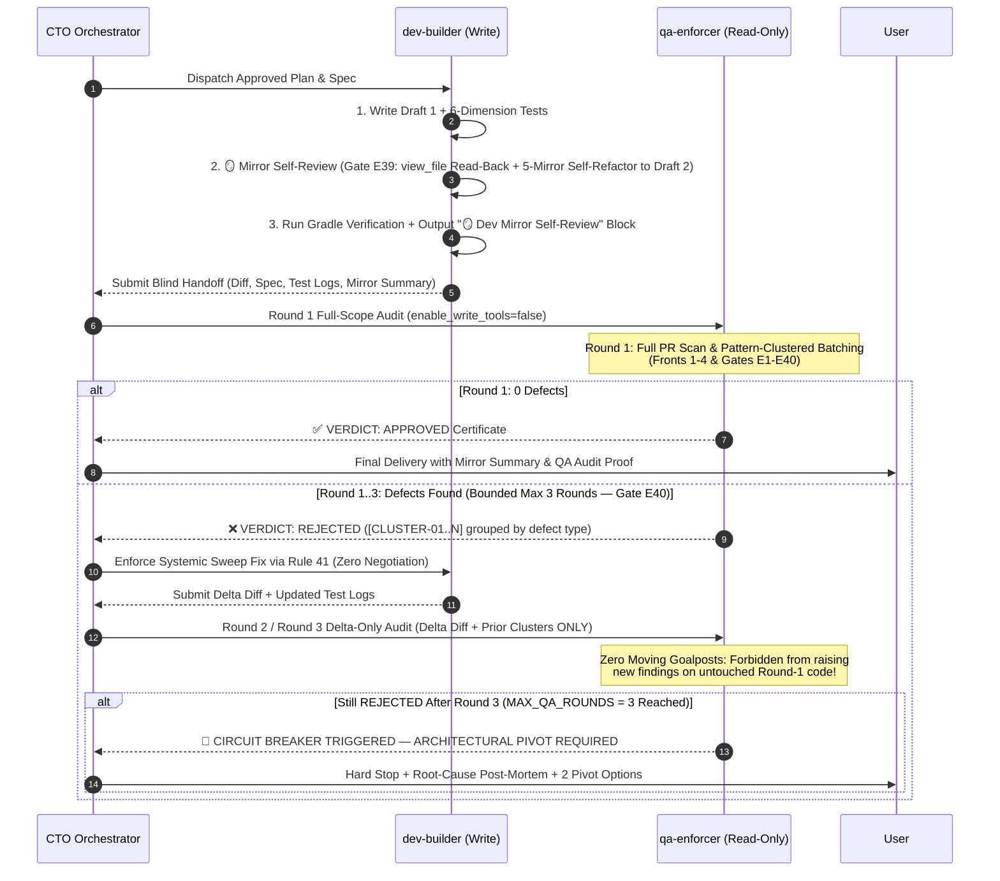

# 42 - ADVERSARIAL RED-TEAM VERIFICATION & ZERO-COMPROMISE DEV ↔ QA AUDIT

## Purpose
This rule defines the mandatory protocol for independent adversarial auditing between **Dev (`dev-builder`)** and **QA (`qa-enforcer`)** to eliminate **Confirmation Bias** (Thiên kiến tự duyệt) and **Implicit Compromise** (Thỏa hiệp ngầm).

**ABSOLUTE MANDATE:** **QA NEVER COMPROMISES WITH DEV.** No agent is permitted to be the final approver of its own code (**Self-Approval is strictly forbidden**). However, **Pre-Handoff Mirror Self-Review (`🪞 Dev Mirror Self-Review` — Gate E39) is 100% MANDATORY** for `dev-builder` (and Main Agent) before any handoff: the builder must physically re-read (`view_file`) and self-refactor its first draft before submitting to the independent, blind-context **`qa-enforcer`** subagent audit.

---

# 1. THE 4 ANTI-COMPROMISE LOCKS (CHỐNG THỎA HIỆP TUYỆT ĐỐI)

When the same agent writes code and acts as the final approver—or when a reviewer agent shares the builder's conversational history—it exhibits sycophancy, excuses minor violations, and tests only the happy path. Conversely, if the builder blindly dumps its first draft without re-reading its own code, avoidable defects pollute the pipeline. To make both **First-Draft Sloppiness** and **QA Compromise** structurally impossible, the system enforces **2 Mandatory Defense Tiers** and **4 Hard Locks**:

* **Tier 1 — Mandatory Dev Mirror Self-Review (Gate E39 — Tự Soi Gương Nội Bộ Trước Bàn Giao):**
  - Immediately after writing/editing code (Draft 1), `dev-builder` (or Main Agent) **MUST physically read back (`view_file` / `git diff`) 100% of the modified files on disk** with a fresh critic lens, audit against the **5 Mirror Lenses** (Minimalism, Self-Documenting Naming, Vitals Survival, Architecture/UI Purity, 6-Dimension Edge Cases), self-refactor into a clean Draft 2, and output a mandatory **`🪞 Dev Mirror Self-Review`** summary block.
* **Tier 2 — Uncompromising Blind-Context QA Audit (Gate E33.4 — Kiểm Toán Độc Lập Cấm Thỏa Hiệp):**
  - After Tier 1 Mirror Self-Review and Gradle test execution pass, `qa-enforcer` audits the code under **4 Hard Locks**:

1. **Lock 1 — Blind-Context Isolation (Cô Lập Ngữ Cảnh Mù):**
   - `qa-enforcer` MUST be spawned as a separate subagent (`define_subagent` + `invoke_subagent`) in a **100% fresh context window**.
   - `qa-enforcer` is never shown Dev's excuses, struggles, or verbal assurances—only: (a) Original Requirements / `spec.md`, (b) Modified file paths & exact `git diff`, and (c) Raw test/build logs.
2. **Lock 2 — Hard Read-Only Tool Boundary (`enable_write_tools = false`):**
   - `qa-enforcer` is physically stripped of write/edit tools (`write_to_file`, `replace_file_content`, shell mutations). It cannot "help" Dev by silently patching code or weakening test assertions to make tests pass.
3. **Lock 3 — Binary Guillotine Verdict (Phán Quyết Nhị Phân — Cấm Cảnh Báo Mềm):**
   - `qa-enforcer` is strictly forbidden from issuing "soft passes", "minor nitpicks", or "conditional approvals".
   - Only two outputs exist: **`VERDICT: APPROVED`** (100% zero violations across all gates and edge cases) or **`VERDICT: REJECTED`** (1 or more defects found).
4. **Lock 4 — No-Argue Remediation Mandate (Lệnh Cấm Cãi & Quyền Phủ Quyết Tối Thượng):**
   - `qa-enforcer` holds **Absolute Veto Power**. When `VERDICT: REJECTED` is issued, `dev-builder` is forbidden from arguing, negotiating scope, or dismissing edge cases. Every `[DEFECT-ID]` must be resolved via **Rule 41 (Minimal Failing Test ➔ Fix ➔ Regression Sweep)** and re-submitted until `VERDICT: APPROVED` is achieved.

```text
❌ FORBIDDEN (First-Draft Dump or Single-Agent Self-Approval):
Dev Agent ──► Codes Draft 1 ──► Skips Reading Back Own Code / Self-Approves ──► Production Bugs

✅ MANDATORY (Tier 1 Mirror Self-Review + Tier 2 Bounded 3-Round Zero-Compromise QA Loop):
dev-builder (Write) ──► Writes Draft 1 ──► 🪞 Physical Read-Back (view_file) & 5-Mirror Self-Refactor (Draft 2)
       │
       ▼ Runs ./gradlew test + Outputs "🪞 Dev Mirror Self-Review" Block
       │
       ▼ Blind Handoff (Round Index + Spec + Full/Delta Diff + Raw Test Logs ONLY)
qa-enforcer (Read-Only, Fresh Context) ──► Prosecutorial 4-Front Audit (Gates E1-E40, Max 3 Rounds)
       │
       ├──► >= 1 DEFECT (Rounds 1-2) ──► "VERDICT: REJECTED" ([CLUSTER-XX] + file:line) ──► Systemic Sweep Fix (Delta-Only Next Round)
       ├──► >= 1 DEFECT (Round 3)    ──► "🛑 CIRCUIT BREAKER TRIGGERED" ──► Stop Patching & Escalate 2 Pivot Options to User
       │
       └──► 0 DEFECTS                ──► "VERDICT: APPROVED" Certificate ──► Unlock User Delivery
```

---

# 2. THE DUAL-AGENT ROLES & MANDATORY DEV MIRROR PROTOCOL

### Dev Agent (`dev-builder` & Main Agent — Write-Enabled)
* **Responsibilities:**
  1. Author clean, minimalist production code adhering to Rule 32 (Ponytail 7-Rung Ladder) and Gates E1–E40.
  2. **Execute the Mandatory 4-Step Dev Mirror Self-Review Protocol (Gate E39) after every code edit:**
     - **Step 1 (Physical Read-Back):** Call `view_file` (and `git diff` when applicable) on 100% of created/modified files to inspect the actual assembled code on disk (never rely on memory of tool edits).
     - **Step 2 (The 5-Mirror Lens Audit):** Critically inspect every line through 5 mirrors:
       - *Mirror 1 (Minimalism & Reuse — Rule 32):* Remove dead imports, redundant intermediate variables, pass-through wrappers, and duplicate logic.
       - *Mirror 2 (Coding Conventions, Naming & Access Modifiers — Gates E28.6–E28.10):* Purge any single-letter (`x`, `c`, `p`, `d`, `h`, `e`, `t`...) or cryptic (`rt`, `pc`, `fc`, `cfg`, `req`, `ctx`...) names; extract magic literals (`delay(3000)`) to `private const val`; enforce affirmative boolean names (`is*`, `has*`, `can*`, `should*`) and 100% `val` / immutable collections in `data class`; add named arguments for multi-boolean/4+ param calls; enforce `internal`/`private` least-privilege access modifiers across App & SDK; and strip trivial comments.
       - *Mirror 3 (Vitals Survival — Gate E38):* Verify zero `!!`, preserved `CancellationException`, `Result<T>` at I/O boundaries, zero main-thread I/O or un-`remember`ed allocations in `@Composable`, `collectAsStateWithLifecycle()`, and proper `onDispose` / `_binding = null` cleanup.
       - *Mirror 4 (Architecture, Compose Modifier & UI Purity — Gates E1–E4.6, E25, E35, E36):* Verify `BaseViewModel`, atomic `_state.update { copy(...) }`, 5-State UI Matrix, 100% `AppTheme` tokens, XML Vector Drawables (0 emojis), `LazyColumn` stable `key`/`contentType`, $\ge 48\text{dp}$ touch targets, Root-Only `modifier` usage (zero reuse of `modifier` parameter on child nodes), and canonical `@Composable` parameter ordering (`Required` ➔ `Callbacks` ➔ `modifier: Modifier = Modifier` ➔ `Optionals` ➔ `Trailing Content`).
       - *Mirror 5 (6-Dimension Edge Cases — Gate E31):* Verify guards and tests for blank/overflow inputs, $<400\text{ms}$ rapid multi-tap re-entrancy, concurrent flow races, and `SavedStateHandle` Process Death restoration.
     - **Step 3 (Immediate Self-Refactor — Draft 1 ➔ Draft 2):** Fix any suboptimal code or violation discovered during the Mirror Audit before running final verification.
     - **Step 4 (Mirror Evidence Report):** Output a concise **`🪞 Dev Mirror Self-Review`** block listing the files re-read, what Draft 1 flaws were caught and self-corrected into Draft 2, and the 5-Mirror pass status.
  3. Implement Pinning Tests (Rule 40), Minimal Failing Tests (Rule 41), and 6-Dimension Boundary Tests (Rule 33), then execute `./gradlew testDebugUnitTest` / `compileDebugKotlin`.
  4. Resolve 100% of `[CLUSTER-XX]` items raised by `qa-enforcer` via a **Systemic Codebase Sweep (`Gate E40.3`)** across all modified files without negotiation.

### Uncompromising QA Agent (`qa-enforcer` — Read-Only)
* **Mindset:** Prosecutorial skepticism with bounded 3-round discipline. Assumes the code contains crashes, leaks, race conditions, and spec drift until proven otherwise by code and tests.
* **Core Mission:** Actively audit and attempt to break the implementation across the **4 Mandatory Audit Fronts**:
  1. **Front 1 — Vitals & Survival (Gate E38):** Zero-Crash (`!!` ban, `CancellationException` preservation, `Result<T>` at I/O boundaries, 5-State UI completeness), Zero-ANR (< 5ms main thread, no un-`remember`ed heavy objects in `@Composable`), Zero-Leak (no `Activity` Context in VM/Singletons, `collectAsStateWithLifecycle()`, proper `onDispose` / `onDestroyView` cleanup).
  2. **Front 2 — Architecture, Coding Conventions, Access/Compose Modifiers & UI Hygiene (Gates E1–E36, E4.6, E28.6–E28.10):** `BaseViewModel` inheritance, atomic `_state.update { copy(...) }`, **Zero single-letter (`x`, `c`, `p`, `d`, `h`, `e`, `t`...) or cryptic abbreviated (`rt`, `pc`, `fc`, `cfg`, `req`, `ctx`...) names (Gate E28.6)**, **Zero magic literals in logic (Gate E28.7)**, **Affirmative boolean naming (`is*`, `has*`, `can*`, `should*`) & 100% `val` immutable `data class` properties (Gate E28.8)**, **Mandatory named arguments for $\ge 2$ booleans / same-type adjacent params or $\ge 4$ params (Gate E28.9)**, **Strict `internal`/`private` least-privilege access modifiers across both App & SDK modules (Gate E28.10)**, **Compose `modifier: Modifier = Modifier` Root-Only application & canonical parameter order (Gate E4.6)**, zero hardcoded colors/dimensions/strings, zero inlined emojis (XML Vector Drawables only), `LazyColumn` `key` & `contentType`, $\ge 48\text{dp}$ touch targets, `safeDrawing` & `imePadding()`.
  3. **Front 3 — 6-Dimension Chaos & Edge Cases (Gate E31):** Empty/blank/10,000-char inputs, Unicode/RTL, rapid multi-tap (< 400ms re-entrancy lock), concurrent 401 token refresh mutex, out-of-order Flow emissions, Process Death (`SavedStateHandle`) restoration.
  4. **Front 4 — Real Execution, Traceability, Mirror & Bounded 3-Round Convergence (Gates E20, E33.3, E39 & E40):** 1-to-1 Gherkin `@Scenario("ID")` test mapping, zero `delay()` + fake stub data in production, verified Gradle test execution logs, mandatory `🪞 Dev Mirror Self-Review` evidence block (Gate E39), and strict adherence to Bounded 3-Round Convergence (`Gate E40`: Round 1 Pattern-Clustered `[CLUSTER-XX]` batching, Rounds 2–3 Delta-Only scope + Zero Moving Goalposts, and Round 3 Circuit Breaker).

---

# 3. THE ADVERSARIAL AUDIT PROTOCOL (BOUNDED 3-ROUND CONVERGENCE)



---

# 4. THE BLIND HANDOFF CONTRACT SPECIFICATION

Before `qa-enforcer` begins auditing, the Orchestrator supplies ONLY objective artifacts:
1. **Round Index (`Round 1 of 3`, `Round 2 of 3`, or `Round 3 of 3`):** Determines whether `qa-enforcer` runs a **Full-Scope Audit (Round 1)** or a **Delta-Only Audit (Rounds 2 & 3)**.
2. **Spec & Scenario IDs:** All Gherkin Scenarios (`@Scenario("ID")`) and acceptance criteria.
3. **Living Traceability Map:** Test functions mapped to each Scenario ID.
4. **The Exact Diff (`Full Diff` in Round 1; `Delta Diff + Prior [CLUSTER-XX] Ledger` in Rounds 2–3):** Modified and newly created file paths + exact diff (after Gate E39 Clean Draft 2 self-refactoring).
5. **Raw Verification Log & Mirror Block:** Unedited console output of passing unit tests, build verification, and the `🪞 Dev Mirror Self-Review` summary block.

---

# 5. QA-ENFORCER GUILLOTINE CHECKLIST (GATES E33.4, E39 & E40)

`qa-enforcer` must fail (`VERDICT: REJECTED`) the submission if ANY item below is unchecked:

- [ ] **Zero-Crash / Zero-ANR / Zero-Leak (Gate E38):** Zero `!!`, preserved `CancellationException`, `Result<T>` at I/O boundaries, zero main-thread I/O, `collectAsStateWithLifecycle()`, zero `Activity` Context leaks.
- [ ] **Architecture, Coding Conventions, Access/Compose Modifiers & UI Token Purity (Gates E1–E4.6, E25, E28.6–E28.10):** Atomic `_state.update`, zero single-letter (`x`, `c`, `p`, `d`, `h`, `e`, `t`) or cryptic (`rt`, `pc`, `fc`, `cfg`, `req`, `ctx`) names, zero magic literals in logic, affirmative boolean names & 100% `val` immutable `data class`, mandatory named arguments, `internal`/`private` least-privilege access modifiers, Root-Only `modifier` & canonical `@Composable` parameter order, 100% theme tokens, XML Vector Drawables (0 emojis), `LazyColumn` stable keys, $\ge 48\text{dp}$ touch bounds, `imePadding()`.
- [ ] **Living Traceability Integrity (Gate E33.3):** Every scenario in `spec.md` has a dedicated, passing automated test. Zero happy-path-only test suites.
- [ ] **Adversarial Input & State Resilience (Gates E30–E31):** Handles blank strings, boundary numbers, malformed payloads, spam clicks (< 400ms debounce/lock), and Process Death (`SavedStateHandle`) without crash or duplicate side-effects.
- [ ] **Minimalist Code & Mirror Self-Review Audit (Rule 32 & Gate E39):** Zero redundant pass-through UseCases, unused wrappers, dead imports, or trivial comments; `🪞 Dev Mirror Self-Review` block present.
- [ ] **Bounded 3-Round Convergence & Systemic Cluster Sweep (Gate E40):** Round index $\le 3$, all identical violations batched into `[CLUSTER-XX]` patterns, Delta-Only scope + Zero Moving Goalposts enforced in Rounds 2–3, and 100% of prior cluster locations resolved via Systemic Codebase Sweep.

---

# 6. THE 4 LAWS OF BOUNDED QA CONVERGENCE & CIRCUIT BREAKER (GATE E40)

To prevent multi-agent oscillation, drip-fed findings (where 59% of late-round defects were already present in Round 1), and 50-round token-burning loops, all `dev-builder` ↔ `qa-enforcer` remediation cycles are strictly governed by **4 Non-Negotiable Convergence Laws**:

1. **Law 1 — Hard 3-Round Cap & Circuit Breaker (`MAX_QA_ROUNDS = 3`, Gate E40.1):**
   - `qa-enforcer` may review a given PR/task at most **3 rounds** (`Round 1`, `Round 2`, `Round 3`).
   - If `qa-enforcer` still issues `VERDICT: REJECTED` at the conclusion of **Round 3**, it MUST output **`🛑 CIRCUIT BREAKER TRIGGERED: ARCHITECTURAL PIVOT REQUIRED`**.
   - Upon Circuit Breaker activation, `dev-builder` is **STRICTLY FORBIDDEN from attempting a 4th patch**. The Orchestrator MUST immediately **HARD STOP** and present to the user: (a) Summary of what was attempted across Rounds 1–3, (b) Root cause of why the current approach cannot converge, and (c) 2 alternative architectural pivot options.
2. **Law 2 — Delta-Only Scope After Round 1 (`Delta-Only Audit`, Gate E40.2):**
   - **Round 1 (Full-Scope Sweep):** `qa-enforcer` scans 100% of modified/created files in the task.
   - **Rounds 2 & 3 (Delta-Only Lockdown):** `qa-enforcer` is **strictly restricted** to auditing ONLY:
     1. Whether the `[CLUSTER-XX]` items reported in the previous round were resolved, and
     2. The **Delta Diff** (lines modified since the previous round and their direct callers) for newly introduced regressions (*Fix-Induced Bugs*).
   - Re-scanning unchanged files or untouched code regions in Rounds 2 & 3 is strictly forbidden.
3. **Law 3 — Pattern-Clustered Defect Batching (`Systemic Cluster Sweep`, Gate E40.3):**
   - `qa-enforcer` is forbidden from reporting isolated, drip-fed single-line defects ("whack-a-mole").
   - In Round 1, all defects sharing the same root pattern or Gate MUST be grouped into a single **Pattern Cluster**:
     - `[CLUSTER-XX] [Gate EXX.X] [Pattern Name] -> Locations: [fileA:line1, fileA:line2, fileB:line3]`: Exact failure mechanism and systemic fix requirement.
   - When resolving a `[CLUSTER-XX]`, `dev-builder` MUST execute a **Systemic Codebase Sweep** across all modified files so that **1 fix pass eliminates 100% of occurrences** of that pattern everywhere at once, paired with Rule 41 verification (`Minimal Failing Test ➔ Systemic Fix ➔ Gate E39 Mirror Self-Review ➔ Full Regression Sweep`).
4. **Law 4 — Zero Moving Goalposts & No Re-Litigation (`4A + 4B`, Gate E40.4):**
   - **4A (Zero Moving Goalposts — Cấm bới lỗi mới ở code cũ từ Vòng 1):** Any code that existed in Round 1, was NOT modified in the Delta Diff, and was NOT flagged by `qa-enforcer` in Round 1 is **permanently grandfathered**. `qa-enforcer` is strictly forbidden from raising new defects on untouched Round-1 code during Rounds 2 or 3.
   - **4B (No Re-Litigation — Cấm nhai lại chuyện cũ):** In Rounds 2 & 3, `qa-enforcer` must not repeat verbose explanations from Round 1 or re-litigate settled design decisions. It outputs a compact cluster ledger (`[CLUSTER-01]: RESOLVED ✅` or `[CLUSTER-02]: UNRESOLVED ❌ [reason]`). Any cluster marked `RESOLVED ✅` is permanently closed unless directly broken by a subsequent Delta Diff edit.

---

# 7. ENFORCEMENT & COMPLIANCE

Any feature, bug fix, or refactor claiming completion without:
1. Executing the **Mandatory 4-Step Dev Mirror Self-Review Protocol (Gate E39)** with a `🪞 Dev Mirror Self-Review` report block,
2. Spawning the independent read-only `qa-enforcer` subagent (`enable_write_tools = false`),
3. Enforcing the **4 Laws of Bounded QA Convergence & 3-Round Circuit Breaker (Gate E40)**, and
4. Obtaining an explicit **`VERDICT: APPROVED`** certificate within $\le 3$ rounds (or escalating via Circuit Breaker on Round 3 failure),

**WILL BE AUTOMATICALLY REJECTED BY GATES E33.4, E39 & E40.**

