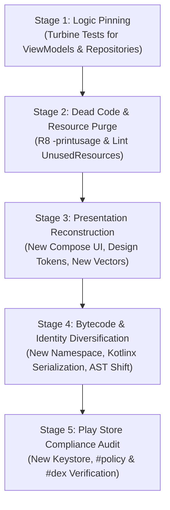

# Clean-Reskin: Architecture-Preserving App Reskinning Engine

## Overview

In modern Android development (2026), **app reskinning** is not just modifying color codes or swapping logos. Google Play employs automated AST (Abstract Syntax Tree) comparison, Control Flow Graph (CFG) analysis, and static asset hashing to identify and ban low-effort copycat and spam applications under the **Repetitive Content Policy**.

The **Clean-Reskin Engine** provides the definitive architectural framework to transform an existing Android app into a distinct, premium product. By leveraging **Clean Architecture** (*"UI is just a detail/plugin"*), it completely reconstructs the Presentation layer and diversifies the compiled bytecode while keeping the **Domain & Data layers 100% intact and correct**.

---

## The 5-Stage Reskinning Lifecycle



---

### Stage 1: Logic Pinning (The Safety Net)

Before deleting or refactoring any code, "freeze" the expected business behavior so any unintentional regressions are caught immediately.

1. **Identify the Core Seams:**
   * **Presentation/Domain Seam:** ViewModel inputs (`UiIntent` / methods) and outputs (`StateFlow<UiState>`).
   * **Data Seam:** Room DAOs, DataStore Preferences, and Repository interfaces.

2. **Establish the Green Baseline with Turbine:**
   Write Characterization Tests verifying the exact state machine:
   ```kotlin
   @Test
   fun `pinning test - verify state machine transitions on user action`() = runTest {
       val fakeRepo = FakeAppRepository()
       val viewModel = MainFeatureViewModel(repository = fakeRepo)

       viewModel.uiState.test {
           // Verify Initial State
           assertEquals(FeatureUiState.Idle, awaitItem())

           // Trigger User Intent
           viewModel.onIntent(FeatureUiIntent.ExecuteAction(id = "123"))

           // Verify State Transition
           assertEquals(FeatureUiState.Success(data = expectedData), awaitItem())
           cancelAndIgnoreRemainingEvents()
       }
   }
   ```
3. **The Golden Rule (Rule 40):** Tests MUST pass (Green Baseline) on untouched code before proceeding to Stage 2.

---

### Stage 2: Systematic Dead Code & Asset Purging

Remove all legacy screens, deprecated UseCases, obsolete DTOs, and unused assets deterministically using compiler-backed tools.

#### 1. Trace Unreachable Code via R8 (`-printusage`)
1. Add this rule to `proguard-rules.pro` temporarily:
   ```proguard
   -printusage build/outputs/dead_code.txt
   ```
2. Execute a release build:
   ```bash
   ./gradlew assembleRelease
   ```
3. Inspect `app/build/outputs/dead_code.txt`. R8 will output every class, interface, method, and field that has **zero callers** across the entire app.
4. **Action:** Safely delete the identified obsolete UseCases, old Activities/Fragments, and orphaned Helper classes.

#### 2. Purge Unused Static Assets via Lint
1. Run the Unused Resources detector:
   ```bash
   ./gradlew lintDebug -Dlint.check=UnusedResources
   ```
2. Open `app/build/reports/lint-results-debug.html`.
3. **Action:** Delete 100% of reported unused XML layouts, drawables (`ic_*.xml`), color definitions, and localized strings.

#### 3. Prune Legacy Dependencies
* Inspect `build.gradle.kts` and remove obsolete libraries (e.g. Gson, old image loaders, unused SDKs). This dramatically shrinks DEX size and removes ancient binary signatures.

---

### Stage 3: Presentation Layer Reconstruction (Compose & XML Full Support)

Since Domain & Data layers are preserved, the Presentation layer can be completely replaced with zero risk of logic breakdown. The engine provides 3 supported implementation paths:

#### Path A: 100% Jetpack Compose Reconstruction
1. **Design Tokens & Theme:**
   * Create an entirely fresh Material 3 theme with **Tonal Surface Hierarchy** (`surfaceContainerLowest` to `surfaceContainerHigh`).
   * Apply **0.5dp Specular Hairline Borders** (`outlineVariant.copy(alpha = 0.35f)`) and negative tracking typography.
2. **Layout Archetype Shift:**
   * Replace vertical `LazyColumn` with **Bento Grid** (`LazyVerticalGrid`) or **Pager Carousel**.
   * Replace Dialogs with **Modal BottomSheet** (`ModalBottomSheet` with drag handle).
3. **State Binding:** Wire new Composables directly to existing ViewModel `StateFlow<UiState>`.

#### Path B: 100% Pure XML Views Reconstruction (Rule 44 & Gate E36)
If your project remains in XML Views, reskinning must adhere to modern XML architecture:
1. **Material 3 XML Theming & Tokens (`res/values/themes.xml`, `colors.xml`):**
   * Inherit from `Theme.Material3.DayNight.NoActionBar`.
   * Define semantic palette: `colorPrimary`, `colorSurfaceContainer`, `colorOutlineVariant`.
   * Use `MaterialCardView` with `strokeWidth="0.5dp"` and `app:shapeAppearanceOverlay` (pill or rounded tokens).
2. **Layout Overhaul (`res/layout/*.xml`):**
   * Redesign XML layouts with modern `ConstraintLayout` or `CoordinatorLayout` + `AppBarLayout`.
   * Enforce **Android 15 Edge-to-Edge** via `ViewCompat.setOnApplyWindowInsetsListener` (Gate E36.3).
3. **ViewBinding & Modern ListAdapter (Gate E36.1 & E36.2):**
   * Use `ViewBinding` with mandatory nullification in `onDestroyView()` (`_binding = null`).
   * Replace legacy `RecyclerView.Adapter` with `androidx.recyclerview.widget.ListAdapter` backed by a background `DiffUtil.ItemCallback`.
4. **State Collection via repeatOnLifecycle (Gate E35.4):**
   * Collect ViewModel `StateFlow` inside `viewLifecycleOwner.lifecycleScope.launch { viewLifecycleOwner.repeatOnLifecycle(Lifecycle.State.STARTED) { ... } }`.

#### Path C: XML-to-Compose Modernization during Reskin (Rule 43 & Gate E35)
Reskinning is the optimal milestone to migrate legacy XML screens to Jetpack Compose without disturbing the backend:
1. **Fragment In-Place Replacement:**
   * In `Fragment.onCreateView()`, return a `ComposeView`.
   * **Mandatory Lifecycle Safety (Gate E35.1):** Call `setViewCompositionStrategy(ViewCompositionStrategy.DisposeOnViewTreeLifecycleDestroyed)` prior to `setContent { }`.
2. **Hybrid Component Interop (Gate E35.3):**
   * Wrap hardware views (CameraX `PreviewView`, AdView, MapView) in `AndroidView` with mandatory `onRelease = { view -> view.destroy() }`.

#### Universal Asset Replacement (Both XML & Compose)
* **100% Fresh Vector Drawables:**
  * Do NOT reuse SVG/PNG icons from the old app (prevents SHA256 resource hash matching).
  * Author newly styled XML Vector Drawables (`res/drawable/ic_*.xml`) with standard `24x24dp` viewports. Both Compose (`painterResource`) and XML (`app:srcCompat`) consume these seamlessly.


---

### Stage 4: Bytecode & Identity Diversification (Renaming, Reordering & AST Scrambling)

Differentiate the compiled DEX bytecode and Abstract Syntax Tree (AST) so that Google Play's static analysis does not flag the app as a clone or template spam.

#### 1. Ubiquitous Language Mapping & Atomic Renaming (Files, Classes, Functions)
Never rename blindly with manual find-and-replace. Establish a **Domain Renaming Dictionary** to shift the app's vocabulary consistently:

| Component Type | Old App Pattern | New Reskinned Pattern | Safe Refactor Tooling |
| :--- | :--- | :--- | :--- |
| **File / Class** | `TimerRepository.kt` | `FocusSessionRepository.kt` | IDE Shift + F6 (Rename Symbol) |
| **ViewModel** | `TimerViewModel.kt` | `SessionCoordinatorViewModel.kt` | Updates DI module binding atomically |
| **Function / Method** | `calculateRemainingTime()` | `computeActiveWindowDuration()` | Rename method + all call sites |
| **Entity / DTO** | `TaskRecordEntity` | `SessionSnapshotEntity` | Match Room `@Entity(tableName = ...)` |
| **DAO Query Method** | `getRecentTasks()` | `queryHistoricalSessions()` | Sync with `@Query` SQL parameter names |

* **Refactoring Invariant:** Perform renaming via IDE symbol refactoring so that all references, DI modules (Hilt `@Provides` or Koin `viewModelOf`), and unit tests update atomically without broken links.

#### 2. Member, Function & Parameter Declaration Reordering (DEX Scrambling)
In the Dalvik Executable (DEX) specification, class definitions (`class_def_item`) store arrays of fields and methods indexed by sequential offsets. Identical member sequences across classes produce identical AST fingerprints in Google's static analysis.
* **Rearrange Member Order:**
  * **Class Members:** Change the order of properties, public functions, and private helper functions within the file (e.g. place internal helpers in different logical groupings rather than sequentially bottom-aligned).
  * **Function Parameters:** Reorder non-default or named parameters in internal functions where appropriate.
  * **File Structure:** Move top-level helper functions, extensions, and sealed subclass definitions into separate files or reorder their definitions in the compilation unit.
* **Impact:** Reordering changes the generated `method_ids`, bytecode offsets, and AST node sequence, directly breaking automated clone/similarity detection while keeping 100% identical functional behavior.

#### 3. Root Namespace & ApplicationId Rebranding
* In `app/build.gradle.kts`:
  ```kotlin
  android {
      namespace = "com.newbrand.zenfocus"
      defaultConfig {
          applicationId = "com.newbrand.zenfocus"
          versionCode = 1
          versionName = "1.0.0"
      }
  }
  ```
* Refactor the root package directory to match the new namespace. This alters 100% of the class signature symbols in the compiled DEX bytecode.

#### 4. Modernize Data Serialization (Reflection Elimination)
* If the old Data layer uses `Gson` or `Jackson`, migrate DTOs to **`kotlinx.serialization`**:
  ```kotlin
  @Serializable
  data class UserProfileDto(
      @SerialName("user_id") val userId: String,
      @SerialName("display_name") val displayName: String
  )
  ```
* *Benefit:* Eliminates runtime reflection metadata from the DEX string pool; R8 can inline serializer calls, completely changing the Control Flow Graph.

#### 5. Safety Seams & DI / Room Verification
After renaming and reordering:
1. **DI Graph:** Verify Koin modules (`verify()`) or Hilt dependency graph compiles cleanly.
2. **Room Database:** Ensure any renamed DAO methods match `@Query` bindings. If changing entity class names, keep `tableName` explicit to avoid accidental schema breaks.
3. **Navigation 3 Routes:** Ensure `@Serializable` route class names match the new feature terminology.
4. **Pinning Tests Check:** Execute the Stage 1 Turbine tests to confirm 100% GREEN baseline.

#### 6. AndroidManifest Cleanup & Modern Architecture
* Ensure a modern **Single-Activity Architecture** (`MainActivity`).
* Remove deprecated permissions (e.g., `READ_EXTERNAL_STORAGE`).
* Declare Android 14/15 modern attributes (`android:foregroundServiceType`, `REQUIRE_SECURE_ENV`).


---

### Stage 5: Play Store Compliance & Release Audit

Before submitting to Google Play Console:

1. **Generate a Fresh Signing Keystore:**
   * NEVER reuse a signing key across different applications.
   * Generate an independent key with modern cryptographic standards (RSA 4096 or EC):
     ```bash
     keytool -genkeypair -v -keystore newapp-release.jks -keyalg RSA -keysize 4096 -validity 10000 -alias newapp
     ```
2. **Execute Full Release Minified Build:**
   ```bash
   ./gradlew assembleRelease testReleaseUnitTest --stacktrace
   ```
3. **Audit DEX Optimization via `#dex`:**
   * Run `./gradlew :app:analyzeReleaseR8Config` to verify Optimization score $\ge 75\%$ and Obfuscation score $\ge 80\%$.
4. **Audit Google Play Policy via `#policy`:**
   * Ensure Zero DCL (Dynamic Code Loading), proper FGS service types, and zero device abuse violations.

---

## Reskinning Compliance Audit Report

When completing a reskin task, output the standard verification summary:

```markdown
### 🚀 App Reskinning & Code Diversification Audit Report

| Audit Vector | Target Requirement | Status | Verdict |
| :--- | :--- | :--- | :--- |
| **Logic Preservation** | 100% Green Turbine Pinning Tests | Verified | ✅ PASS |
| **Dead Code Purged** | R8 `-printusage` scanned & cleaned | 0 dead classes | ✅ PASS |
| **Unused Assets Purged** | Lint `UnusedResources` clean | 0 unused assets | ✅ PASS |
| **Presentation Layer** | 100% New UI (Compose / Pure XML) | Reconstructed | ✅ PASS |
| **Vector Assets** | 0 SHA256 collisions with old app | 100% New Vectors | ✅ PASS |
| **File & Function Renaming** | Domain Mapping via Shift + F6 | 100% Renamed | ✅ PASS |
| **Member & Method Reordering**| Declaration order scrambled | DEX Offsets Shifted | ✅ PASS |
| **Bytecode Diversification**| New Namespace & `kotlinx.serialization` | Applied | ✅ PASS |
| **Identity & Signing** | New ApplicationId & Fresh RSA Keystore | Configured | ✅ PASS |
| **DEX & Policy Gates** | Pass `#dex` (E26.6–E26.9) & `#policy` (E29) | Verified | ✅ PASS |
```
