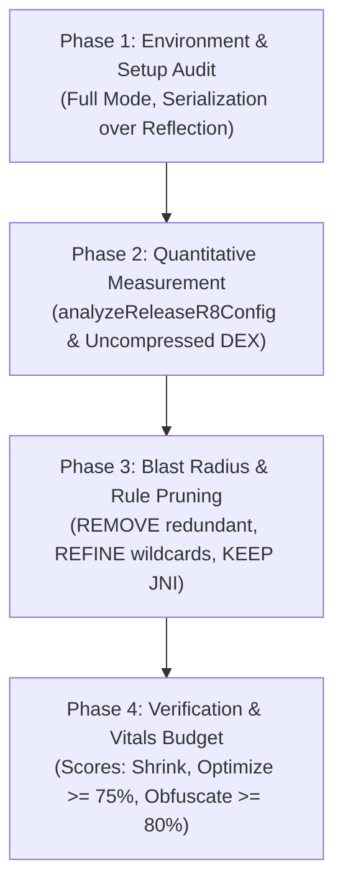

# DEX Code Optimization & R8 Hygiene Engine

## Overview

Based on official Android App Quality standards ([DEX code optimization](https://developer.android.com/topic/performance/issues/code-optimization)), **dex-optimization** provides the complete engineering workflow to measure, audit, and maximize the shrinking, optimization, and obfuscation of Android DEX bytecode.

This skill eliminates app bloat, accelerates Cold App Startup (TTID/TTFD), minimizes runtime RAM page-faults, and clears Google Play Console DEX optimization alerts.

---

## The 4-Phase Optimization Protocol



---

### Phase 1: Environment & Configuration Audit

1. **Verify R8 Full Mode:**
   Inspect `gradle.properties`:
   - **Mandatory:** `android.enableR8.fullMode=true` (or unset if AGP >= 8.0 where it is default).
   - **BANNED:** `android.enableR8.fullMode=false`. If present, remove immediately.

2. **Verify Compile-Time Serialization:**
   - Scan dependencies for reflection-heavy parsers (`Gson`, raw Jackson).
   - Enforce `kotlinx.serialization` or Moshi KSP (`@JsonClass(generateAdapter = true)`). Compile-time serialization eliminates the need for broad reflective keep rules, allowing R8 to inline getters, devirtualize calls, and prune unused fields.

3. **Verify Module Consumer Rules:**
   - Ensure every library/feature module declares `consumerProguardFiles("consumer-rules.pro")` so internal data models are self-protecting.

---

### Phase 2: Quantitative Measurement & Diagnostics

1. **Measure Local Uncompressed DEX Size:**
   Run on the release AAB bundle:
   ```bash
   unzip -l <yourapp>.aab | grep -E '\.dex$' | awk '{sum+=$1} END {print sum}'
   ```
   *Threshold:* Uncompressed DEX must not grow unchecked. Every 1MB of DEX overhead adds 15–30ms of startup class-loading delay on mid-tier hardware.

2. **Run R8 Configuration Analyzer:**
   - **Standalone Task (AGP >= 9.3 or R8 >= 9.3.7-dev - Recommended):**
     ```bash
     ./gradlew :app:analyzeReleaseR8Config
     ```
     *Benefit:* Runs in seconds without building the full APK/AAB. Generates the interactive HTML report at `app/build/reports/r8/r8-config-analyzer-release.html`.
   - **Standard Release Build (AGP < 9.3):**
     ```bash
     ./gradlew :app:assembleRelease
     ```
     Inspect the generated report at `app/build/outputs/mapping/release/configanalyzer.html` or inspect `BUNDLE-METADATA/com.android.tools/r8.json` inside the `.aab`.

---

### Phase 3: Blast Radius Analysis & Keep Rule Pruning

Categorize every keep rule in `proguard-rules.pro` into the **3-Tier Decision Matrix**:

| Action | Target Pattern | Rationale & Remediation |
| :--- | :--- | :--- |
| **REMOVE** | **Redundant Library Rules**<br>Rules for Retrofit, OkHttp, Moshi, Room, Kotlinx Serialization, Hilt, Koin, Coil | These libraries bundle their own `consumer-rules.pro`. Manually adding them bloats keep scope and prevents newer library optimizations. **Delete them.** |
| **REFINE** | **Broad Wildcard Rules**<br>`-keep class com.app.** { *; }` or broad `-keep class *` | Massive blast radius. Forces R8 to retain dead code, prevents class merging and method inlining across the entire package. **Refine to exact classes or `@Keep` annotations.** |
| **KEEP** | **Legitimate Runtime Seams**<br>JNI C/C++ entrypoints, Reflection for dynamic plugin loading | Essential for runtime stability. Ensure signatures use exact member patterns rather than blanket `*`. |

#### Example: Refining Wildcards
**Anti-Pattern (Violates Gate E26.7):**
```proguard
# BAD: Huge blast radius, freezes entire domain layer from optimization
-keep class com.company.app.data.model.** { *; }
```

**Clean Pattern (Complies with Gate E26.7 & E26.4):**
```proguard
# GOOD: Protect only properties of classes marked with @Serializable or @Keep
-keepclassmembers class * {
    @kotlinx.serialization.Serializable <fields>;
}
```

---

### Phase 4: Release Verification & Quality Gates

1. **Verify Metrics Against Antigravity Vitals Budget:**
   - **Optimization Score:** $\ge 75\%$
   - **Obfuscation Score:** $\ge 80\%$
   - **Shrinking:** Dead code removed without runtime regressions
   - **Google Play Vitals:** Zero warnings on Play Console DEX Code Optimization

2. **Execute Full Release Minified Verification:**
   ```bash
   ./gradlew assembleRelease testReleaseUnitTest --stacktrace
   ```
   Ensures that aggressive inlining and obfuscation do not cause runtime `ClassNotFoundException`, `NoSuchMethodError`, or serialization failures.

---

## Deliverable Audit Report Format

When executing `#dex` or auditing DEX optimization, output the structured report:

```markdown
### 📊 DEX Code Optimization & R8 Hygiene Audit Report

| Metric | Target Budget | Current Status | Verdict |
| :--- | :--- | :--- | :--- |
| **R8 Full Mode** | Enforced (`true`) | Enabled in `gradle.properties` | ✅ PASS |
| **Optimization Score** | $\ge 75\%$ | $82.4\%$ | ✅ PASS |
| **Obfuscation Score** | $\ge 80\%$ | $88.1\%$ | ✅ PASS |
| **Wildcard Package Keeps** | Zero (`0`) | 0 found | ✅ PASS |
| **Redundant Library Rules** | Zero (`0`) | 0 found | ✅ PASS |
| **Uncompressed DEX Size** | Monitored baseline | 8.2 MB | ✅ PASS |

#### Keep Rules Pruning Actions
- [x] Removed redundant Retrofit/OkHttp keep rules (handled by AAR consumer rules).
- [x] Refined `com.company.app.model.**` into targeted `@Serializable` keep attributes.
- [x] Verified zero runtime crashes via `./gradlew assembleRelease testReleaseUnitTest`.
```
