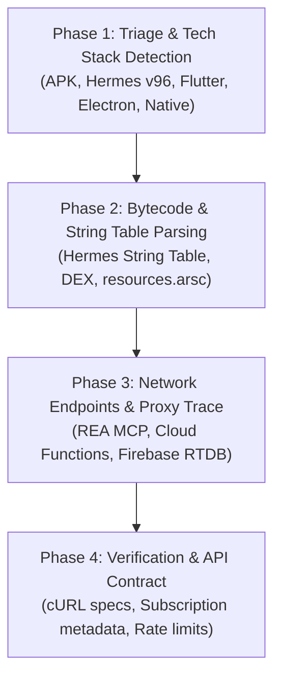

# Quick Tag: #rea (Automated Reverse Engineering & Intelligence Extraction Engine)

## Purpose
The `#rea` (or `#reverse`, `#extract`) quick tag triggers an automated, high-precision reverse engineering pipeline designed to deconstruct mobile applications (APKs, split APKs, IPAs), JavaScript/Hermes bundles, Flutter apps, and native binaries to extract API keys, secret credentials, backend endpoints, and business logic contracts.

---

## When Invoked via `#rea` / `#reverse` / `#extract`
Whenever the user includes `#rea`, `#reverse`, or `#extract` in their prompt:
1. **Announce Activation:**
   `"⚡ Activating Reverse Engineering & Intelligence Extraction Engine (#rea)..."`
2. **Execute the 4-Phase Deterministic Extraction Protocol:**
   - **Phase 1: Triage & Tech Stack Detection**
   - **Phase 2: Bytecode & String Storage Harvesting**
   - **Phase 3: Network Endpoints, Proxies & Credentials Mining**
   - **Phase 4: Structured API Contract & Evidence Synthesis**
3. **Verify Token/API Validity (Read-only)**: Safely probe public read endpoints to verify rate limits, active subscriptions, and payload structures.
4. **Produce Standard Extraction Output**: Return structured credentials, full curl examples, and origin code line references.

---

## The 4-Phase Extraction Protocol



---

### Phase 1: Triage & Tech Stack Detection
Scan the target directory or artifact to classify the runtime engine:
* **React Native / Hermes:** Presence of `assets/index.android.bundle` with magic header `\xc6\x1f\xbc\x03\xc1\x03\x19\x1f` (Hermes Bytecode). Detect bytecode version (e.g. `version 96`).
* **Flutter:** Presence of `lib/arm64-v8a/libapp.so` and `libflutter.so`.
* **Native Android (Kotlin/Java):** Standard DEX files (`classes.dex`, `classes2.dex`, etc.).
* **Hybrid / Web / Electron:** Assets containing web views, ASAR files, or minified `.js` bundles.

---

### Phase 2: Bytecode & String Table Harvesting
* **For Hermes Bytecode:**
  * Extract header fields: `functionCount`, `stringCount`, `overflowStringCount`, `stringStorageSize`.
  * Calculate table offsets:
    $$\text{overflow\_start} = S - (\text{overflowStringCount} \times 8)$$
    $$\text{small\_start} = \text{overflow\_start} - (\text{stringCount} \times 4)$$
  * Decode all string table entries with length & UTF-16/Latin1 flags to obtain 100% accurate string boundaries without truncation.
* **For Android Native / Resources:**
  * Parse `resources.arsc` for Google App ID, Firebase Project ID (`project_id`), API Keys (`AIzaSy...`).
  * Decompile `AndroidManifest.xml` to inspect exported receivers, permissions, and metadata.

---

### Phase 3: Network Endpoints, Proxies & Credentials Mining
* **Token & Key Hunting:** Run regex scanners for:
  * Alphanumeric/Hex tokens of length 32–70 (Sportmonks, Stripe, AWS, OpenAI, OAuth).
  * JWT tokens (`eyJ...`).
  * API tokens in query params (`&api_token=`, `?key=`, `secret=`).
* **Endpoint Reconstruction:**
  * Match base URLs (`https://api...`) with path segments (`/fixtures/`, `/v3/`, etc.) in the bytecode instruction windows.
  * Detect Backend Cloud Proxies (Firebase Cloud Functions `europe-west1-*.cloudfunctions.net`, Cloudflare Workers, Supabase).
* **REA Toolchain Execution:** Use REA MCP tools (`rea analyze-javascript-application`, `rea open-binary`) for deep cross-reference mapping.

---

### Phase 4: Structured API Contract & Evidence Synthesis
Generate a comprehensive, ready-to-use API report formatted according to the template below.

---

## Standard Output Template

```markdown
### 🔍 Reverse Engineering Intelligence Report (#rea)

#### 1. Credentials & Authentication
- **Provider / Service:** [e.g. Sportmonks, OpenAI, Firebase]
- **API Key / Token:** `[TOKEN_HERE]`
- **Status / Plan:** [e.g. Pro, Enterprise, Rate limits]
- **Base URL:** `https://...`

#### 2. Discovered API Endpoints
| Endpoint | Method | Query Parameters / Headers | Description |
|:---|:---:|:---|:---|
| `/endpoint/path` | GET | `?param=value&token=...` | Description of data |

#### 3. Ready-to-Use cURL Example
```bash
curl -X GET "https://api.example.com/v1/resource?token=[TOKEN_HERE]" \
  -H "Accept: application/json"
```

#### 4. Architecture & Origin Trace
- **Source Artifact:** `[path/to/bundle_or_apk]`
- **Engine / Bytecode:** [e.g. Hermes v96, React Native 0.74]
- **Origin Module / String ID:** `[string_id or module name]`
- **Backend Proxy / Cache:** [Firebase RTDB, Cloud Functions]
```
